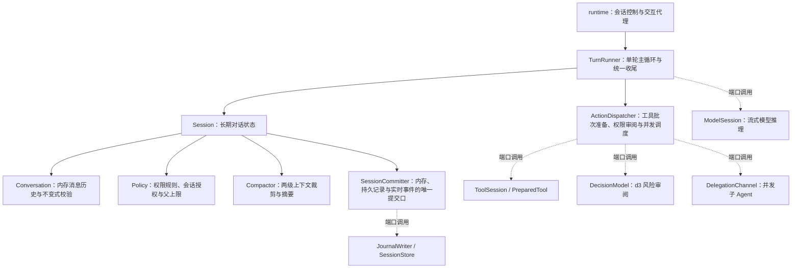
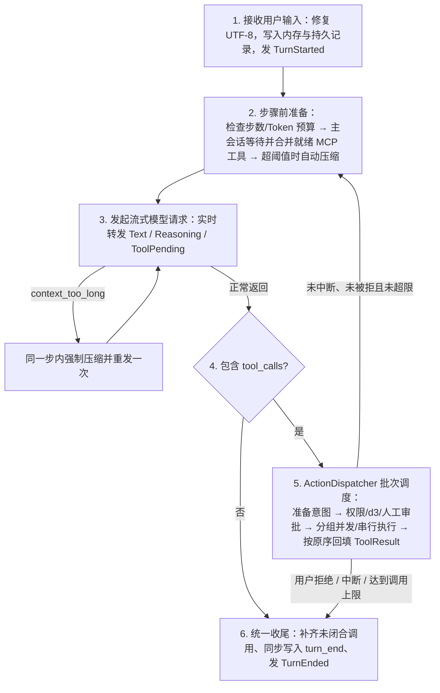
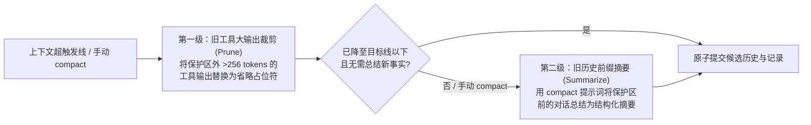

# agent：核心业务对象与执行循环

`agent` 模块（`dagent_agent`）是 DAgent 的核心业务层，**仅依赖 `base`**。它负责将用户输入转化为「请求模型 → 权限审阅与工具并发调度 → 回填结果与持久化」的闭环，并维护对话上下文不变式、多级权限策略、上下文自动压缩以及崩溃恢复。

所有外部 I/O（模型请求、工具执行、SQLite 存储、MCP 连接管理、子 Agent 委派）均通过 `agent/port/` 下的抽象端口由外层实现注入。

## 1. 核心架构与组件关系



### 线程安全边界
- **会话执行线程单写者**：`Session` 的对话历史、工具目录更新、模型调用与持久化提交严格限制在所属的唯一会话执行线程上串行推进。
- **跨线程并发点**：只读工具并行组、并发 `task` 子会话、以及普通工具执行均在受控的临时 worker 线程运行；它们通过线程安全的 `Sink` 发送实时输出，并通过 `ExecutionMailbox` 将运行中网络审批或子会话父审阅请求交回主执行线程串行处理。跨线程仅开放 `Policy` 的模式切换/授权撤销与 `stop_token` 取消。

## 2. 一轮执行主循环（`TurnRunner`）

一次用户输入对应一轮（Turn），内部可包含多步（Step）模型请求与工具调用批次（Batch）：



### 关键循环与配额规则
- **共享预算与宽限总结（`BudgetedModel`）**：每轮限制最大模型调用次数（默认 100）、最大工具调用次数（默认 200）及可选的总 Token 预算。主请求、重试、自动压缩摘要与父模型审阅共享该预算。当工具调用次数触达上限时，若仍有剩余模型步数，系统开启宽限步（`grace`），在请求中**清空全部可用工具列表**，让模型基于已有结果完成最后一次纯文本总结后再以 `limit` 状态收尾。
- **中断与历史闭合保证**：在任何阶段触发取消（`stop_token`），系统等待所有在途工具线程安全退出，保留已有部分正文并附加中断说明，为所有尚未完成或跳过的工具调用补齐「未执行」结果，确保消息历史始终闭合。

## 3. 消息历史与协议不变式（`Conversation`）

模型 API 对消息序列有严格的结构要求，`Conversation` 在每次构建请求前强制校验以下不变式：
1. **I1 工具批闭合**：带 `tool_calls` 的 `assistant` 消息后，必须紧跟数量、ID 与顺序完全一致的 `tool` 结果消息。
2. **I2 非空回复**：`assistant` 消息必须包含正文或工具调用（仅含思考内容不合法）。
3. **I3 结果归属**：不允许出现无对应前序调用的游离 `tool` 消息。
4. **I4 起始角色**：非空历史必须以 `user` 消息（含压缩摘要）开头。
5. **I5/I6 独立系统提示与合法 UTF-8**：`system` 提示词在会话期间保持前缀固定（利于服务端前缀缓存），所有入库与外发文本强制为合法 UTF-8。

## 4. 工具调度与并发分组（`ActionDispatcher`）

当模型在单条回复中返回多个工具调用时，`ActionDispatcher` 在保证**状态一致性与结果按原序提交**的前提下最大化并发：

```text
tool_calls ──► ActionCatalog 准备 ──┬─► 控制动作 (ask/exit_plan/todo/task/skill)：由核心规则直接处理
                                    └─► 普通工具 (PreparedTool) ──► Policy 判权 (Allow / d3 / Ask / Deny)
                                                                       ├─► 连续只读工具组 (并行，最多 max_parallel_tools)
                                                                       ├─► 连续 task 子任务组 (并行，最多 max_parallel_tasks)
                                                                       └─► 写入/编辑/Web/MCP/Memory (严格串行)
```

1. **动态分组与延迟重准备**：只有被 `Policy` 直接放行的 `read`/`grep`/`glob`、只读沙箱 `bash` 以及 `todo` 计划更新可进入只读并行组；连续的 `task` 调用组成独立的子任务并行组；`ask`/`exit_plan` 等交互动作及写入类工具严格单发串行。当遇到不可加入当前挂起组的调用（如 `read a` 后紧跟 `edit a`，或需要弹窗审批的调用）时，**先运行并等待当前挂起组全部完成，再重新 `prepare` 当前调用**——从而确保后一个 `edit` 能拿到前一个 `read`/`edit` 更新后的最新文件指纹与内容。
2. **有序前缀尽早提交**：尽管组内工具并行执行，结果的持久化与 `ToolFinished` 事件严格按模型原始调用顺序提交；一旦连续前缀就绪便立即落盘，避免后续崩溃丢失已完成的工作。

<a id="7-权限与沙箱"></a>
## 5. 权限与沙箱策略（`Policy`）

核心权限层根据当前模式（`ask` / `workspace` / `unrestricted`）、正交的只读/规划开关（`read_only` / `plan`）以及路径分类（工作区内普通路径、工作区外路径、`.git` 与 Home 控制面受保护路径、`.env`/`*.key`/`.ssh` 等敏感路径）作出决策：

| 权限模式 | 核心行为边界 |
| --- | --- |
| `ask` | 工作区内普通读取与已知只读 Bash（放入 `read_only` 沙箱）自动放行；文件写入与非只读命令均需人工审批 |
| `workspace`（默认） | 工作区内普通文件读写自动放行；非只读 Bash 在完整 `workspace` 沙箱（禁止写工作区外、禁止写 `.git`/控制面/敏感文件、网络默认拦截）内自动执行；边界操作可交由 [d3 决策模型](d3-authorization.md) 风险优先审阅 |
| `unrestricted` | 普通文件与命令直接放行（Bash 使用宿主权限）；但语法错误、高危命令硬拦截、`read_only`/`plan` 限制依然强制生效，且 `web` 工具仍强制运行在只读沙箱内 |

### 启动自检未找到可用沙箱时
若启动时 MXC 沙箱探针未通过（如缺少宿主 `bwrap`/`slirp4netns`、AppArmor 限制或 Windows 容器限制），系统遵循**失败关闭**：自动禁用 `workspace` 权限档（回退为 `ask`）与 `web`/`grep`/`glob` 等强依赖只读沙箱的工具，并在界面显著提示原因；`ask` 模式下的 Bash 命令每次均需显式审批宿主执行（`host_command`）。

### 会话授权与即时撤销
人工审批支持「单次允许」或「本会话允许」（敏感文件读取、受保护写入与显式宿主访问仅限单次）。用户随时可在 `/permissions` 面板撤销某条会话授权：权限修订号立即递增，**正在运行中且依赖该已撤销授权（或已撤销网络域名）的活跃工具/网络连接会被立即中止**。

### 子 Agent 的权限派生
子 Agent 的权限遵循**只收窄、不放宽、会话授权双向不继承**原则：
- 父会话的 `unrestricted` 不会遗传给子 Agent（最高降级为 `workspace`）；父会话运行中切换权限或降权会通过活上限（`set_parent_cap`）实时作用于所有活跃子 Agent。
- 当子 Agent 触发审批时，若父会话处于 `workspace` / `unrestricted` 且配置允许，优先通过父邮箱交由**父模型独立审阅**（不污染父对话历史）；父审阅拒绝、超时或不适用时再转交人工审批弹窗。

### 控制动作：ask、exit_plan、todo、task
这五个动作（含 `skill`）在模型侧表现为工具，但在核心内部直接解析为类型化控制请求执行：
- `ask`：向用户弹出单选/多选问题（每轮最多 3 次），结果记入历史。
- `exit_plan`：在只读 `plan` 模式下提交规划总结，请求用户确认切换至 `workspace` 或 `ask` 开始实施。
- `todo`：全量更新当前会话的工作计划（`WorkPlan`）并持久化 `TodoView`。
- `task` / `skill`：委派并发子 Agent（见 §9）或按轮激活技能指令（见 [skills](skills.md)）。

## 6. 上下文预算与两级自动压缩（`Compactor`）

每次主请求前估算包含 `system`、工具定义与有效历史的总 Token 数（并结合服务端返回的真实 `prompt_tokens` 动态校准估算器）。当超出触发阈值（默认可用窗口的 80%）或收到服务端 `context_too_long` 时，在保留**尾部保护区**（至少保留最近一批工具调用及其结果）的前提下执行两级压缩：



- **只读计算与原子安装**：`Compactor` 在历史副本上计算候选变更，若摘要中途被用户取消，原历史分毫无损；成功后由 `SessionCommitter` 一次性替换内存历史并写入 `prune` / `compaction` 记录。若摘要调用失败，安全退化为按完整批次丢弃最旧前缀。

## 7. 会话记录、崩溃恢复与历史投影

持久化采用事件溯源（Event Sourcing）模式，定义了 `system`、`user`、`assistant`、`tool_started`、`tool`、`permission`、`permission_revoked`、`unrestricted_ack`、`parent_review`、`auto_review`、`delegation_context`、`prune`、`compaction`、`turn_end` 等结构化记录：

1. **统一提交入口（`SessionCommitter`）**：保证内存状态更新、持久化日志追加与前端实时事件发送的顺序严格一致（如工具必须先落盘 `tool_started` 再发送事件并执行）。
2. **崩溃闭合与恢复（`SessionRecovery`）**：恢复会话时按序重放记录重建内存 `Conversation`、`WorkPlan` 以及最近最多 3 条真实用户原话（供后续 d3 与父模型审阅还原意图上下文）。若发现上次运行因崩溃未写入 `turn_end`，自动为悬空的工具调用补齐「崩溃时结果未知，修改前请先检查状态」的提示，追加 `turn_end{crashed}` 闭合旧回合，并按当前环境重新渲染写入新的 `system` 记录。
3. **只读历史投影（`HistoryProjector`）**：前端浏览历史会话时，直接将存储记录流式映射为界面展示项（`HistoryItem`），不删除被压缩过的早期历史，也不触发模型或 MCP 初始化。

<a id="11-mcp-生命周期"></a>
## 8. MCP 生命周期

后端启动时由 `tools::McpHub` 在后台并发连接所有配置的 MCP 服务，**不阻塞进程启动**；主会话在每一步模型请求前（`begin_step`）等待连接完成并合并工具列表，防止首轮因工具尚未就绪而失败。若运行中某个 MCP 服务意外断开，核心在工具结果中提示模型，并在下一步边界自动执行唯一一次重连。

<a id="12-子-agent-与-task"></a>
## 9. 子 Agent 与 task

`task(agent, prompt)` 根据 `<home>/agents/*.md` 中的角色定义，在独立上下文与独立会话记录中启动子 Agent：
- **单层树状隔离**：禁止二级嵌套（子会话不含 `task`、`ask`、`exit_plan`、`memory`，且默认不含未显式声明的 `mcp__*` 工具）。
- **结果收敛**：并发子任务各自运行独立回合，父会话仅接收最终总结文本与步骤摘要（`TaskView`），从而将大规模探索或子模块实现的中间 Token 消耗完全隔离在子上下文内部。
