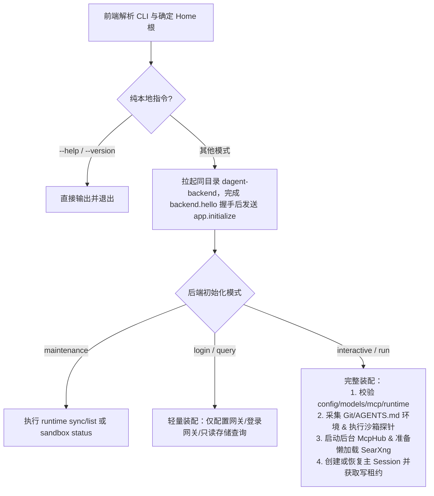

# app：启动入口、配置体系与装配

`app` 模块位于架构最外层，负责连接前端 CLI/UI 与后端核心运行时，分为两个无交叉依赖的静态库与两个可执行入口：
- **前端（`dagent` = `dagent_app_cli` + `dagent_ui`）**：解析命令行、定位安装根、拉起后端进程，并驱动全屏 TUI 或 `run` 非交互输出。
- **后端（`dagent-backend` = `dagent_backend` + `dagent_app_config`）**：加载并校验配置、准备工具链与沙箱、管理 SearXNG / MCP 生命周期，并实现 `runtime` 与 `backend` 的全部装配与查询端口。

## 1. 启动与后端装配流程



- **单一自包含 Home**：启动时按 `DAGENT_HOME` → 开发树 `home/` → 可执行文件真实目录确定唯一根目录，并探测目录可写性（目录结构见 [home](home.md)）。
- **按模式裁剪装配开销**：`sessions`、`--list-models` 与 `login` 模式采用轻量级装配，不收集 Git 环境、不执行沙箱探针、也不启动 MCP 连接，做到毫秒级响应。

## 2. 配置与提示词

所有配置集中在 `<home>/config/` 下，仅由后端读取，不做多层级目录合并：

| 配置文件 | 核心内容与安全校验 |
| --- | --- |
| `config.json` | 运行配额（`run`）、子任务审批（`subagents.approval`）、沙箱网络与额外路径（`sandbox`）、工具与文件上限（`tools`/`files`）、网页（`web`）、记忆（`memory`）、上下文预算（`context`）、UI 外观与布局（`ui`）、HTTP 与日志策略 |
| `models.json` | 默认生成模型、模型字典（`models`）及可选决策模型（`decision` / `decision_models`）。**强制要求 `0600` 私有权限**；`api_key` 支持字面量或 `env:VAR`，与 `login: "opencode"` 互斥 |
| `mcp.json` | MCP 服务连接与超时配置。**强制要求 `0600` 私有权限**，且每个服务必须显式声明 `permissions.{read, write, network}` |
| `runtime.json` | 托管工具版本、MXC 原生库与消费者独立依赖环境声明（见 [toolchain](toolchain.md)） |

### 关键配置机制
1. **保序原子更新**：用户在 UI 中添加模型或保存外观/布局设置时，后端获取 `run/models.lock` 排他锁，基于 `ordered_json` 局部更新字段并保留原文件的键顺序、注释与缩进风格，经同目录临时文件 + `fsync` + `rename` 原子落盘。
2. **命令行单次覆写（`--set` / `--model`）**：支持在启动时按参数顺序临时覆盖配置项，仅对当前后端实例生效，不写回磁盘。配置中的相对路径默认相对 Home，而 `--set` 中的路径参数（除主题名外）与 `sandbox.extra_*` 相对当前工作目录 `cwd` 解析。
3. **提示词模板快照与纯文件系统 Git 根探测**：主提示词（`prompts/system.md`）与压缩提示词（`prompts/compact.md`）在后端启动时读取，在新建或恢复会话时注入工作区环境、Git 状态、层级 `AGENTS.md`、技能摘要与记忆索引完成一次性渲染。其中工作区所属 Git 仓库根（`project_root`）通过纯文件系统向上查找 `.git` 确定，绝不在未建立沙箱前调用外部 `git rev-parse` 命令。

## 3. 命令行与子命令

```text
dagent [选项] [初始提示词…]          进入全屏交互界面 (TUI)
dagent run [选项] <提示词…>          非交互执行一轮任务并退出
dagent sessions                      列出当前工作目录的历史会话
dagent --list-models                 列出已配置的公开模型
dagent login [opencode]              执行设备码登录（无参数时仅查看本地登录状态）
dagent logout <opencode>             清除指定提供方的本地登录凭据
dagent runtime sync / list           同步下载或查看托管工具与依赖环境
dagent sandbox status                全面诊断沙箱运行时、宿主前置与真实隔离探针结果
```

- **工作目录精确归属**：`-C / --cwd`（默认启动目录）规范化后作为会话归属、相对路径解析与沙箱可写边界的唯一基准；`--continue` 与 `--resume` 仅在当前精确 `cwd` 下匹配会话。

## 4. run 输出与信号处理

### 4.1 非交互模式输出格式（`dagent run --output`）
- `text`（默认）：stdout 在回合结束时一次性输出最终回复正文；stderr 实时打印工具进度、告警与等待心跳。
- `json`：stdout 在结束时输出包含 `session_id, status, error, result, steps, tool_calls, usage, duration_ms` 的单行汇总 JSON。
- `jsonl`：stdout 逐行实时输出完整的协议事件信封（`protocol::Event`，包含展平的子 Agent 事件与操作通知），适合程序化集成。
- **非交互 `unrestricted` 确认降级**：`dagent run` 无人工弹窗入口，若以 `--permissions unrestricted` 启动，前端先向 `stderr` 打印风险警告（不污染 stdout 数据流）并自动确认本次运行生效；后端不将该自动确认持久化到会话记录，确保该会话后续在 TUI 中恢复时仍会弹窗提示。

### 4.2 信号、管道断开与退出码约定
- **全局忽略 `SIGPIPE`**：前后端进程启动时全局忽略 `SIGPIPE`，写已关闭管道时统一转化为 `EPIPE` 错误码而非被信号直接杀死；在 `run` 模式下，若 stdout 管道断开（如下游 `head` 提前退出），前端立即向后端发送 `run.cancel` 并以退出码 `1` 终止。
- **两段式优雅中断**：前端捕获首次 `SIGINT` / `SIGTERM`（或 Windows `Ctrl-C`/`Ctrl-Break`）时，向后端发送 `run.cancel` 请求优雅中断当前回合；若再次收到中断信号或处于非运行阶段，立即以退出码 `130` 终止。
- **标准退出码**：`0`（正常完成）、`1`（运行/模型/通信/管道写入失败或被拒绝）、`2`（命令行参数或配置文件错误）、`130`（信号中断）。
