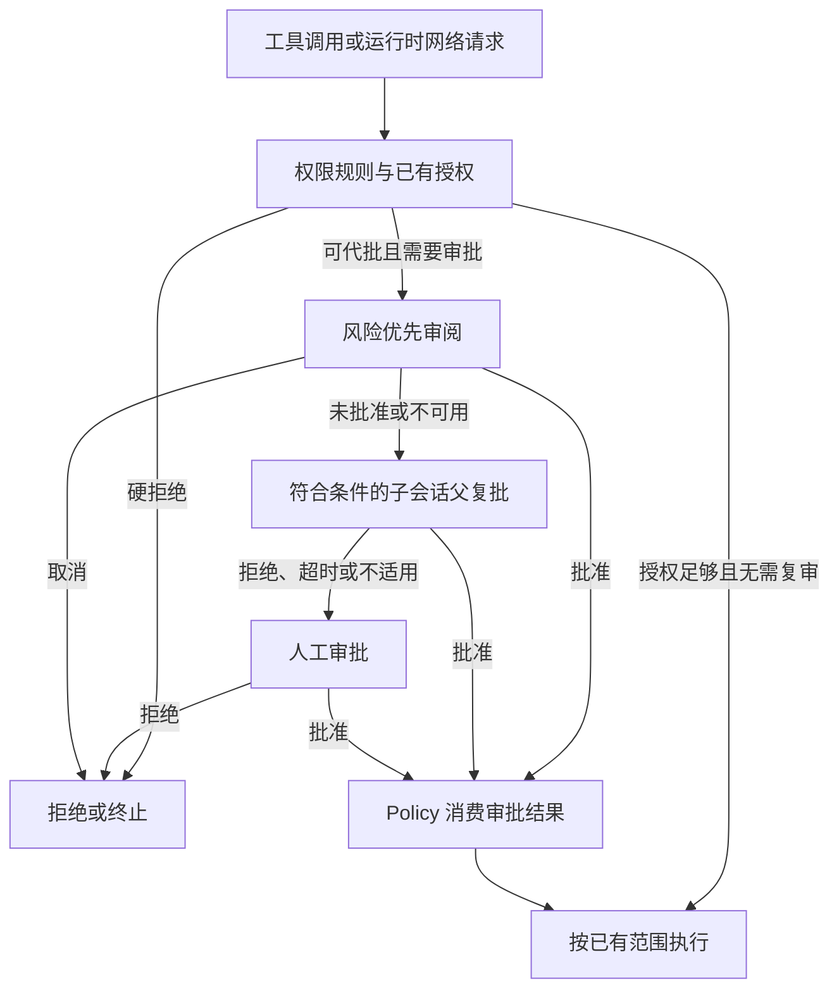

# d3 授权与风险优先审阅

描述当前实现。d3 是独立的决策模型，负责为可代批操作评分；权限规则、执行授权和审批路由仍由 Agent 核心管理。
当前问句版本为 `risk-first-v2`，随安装提供固定配置 `risk-first-v2-fixed-20261018`。
实验结果与适用范围见 [阈值实验报告](../report/d3-threshold-experiments.md)，使用配置见 [权限与沙箱](../guide/permissions.md)。

## 1. 职责与边界

生成模型提出工具调用，决策模型判断操作是否可在当前范围内自动批准，两者使用独立端口、配置和请求。
决策模型不执行命令、不修改权限规则，也不直接生成 `ExecutionGrant`。

| 模块 | 职责 |
| --- | --- |
| `app/config.*`、`app/bootstrap.*` | 读取决策模型选择、装配客户端与存储、绑定版本 |
| `app/decision_profile.*` | 加载阈值文件，核对完整身份并解析场景参数 |
| `agent/decision_types.hpp`、`agent/port/decision.hpp` | 场景、评分、阈值、证据、结果与外部端口 |
| `agent/policy/decision_review.*` | 构造 state、提供固定问句、风险分流、授权判定、网页抽样与理由 |
| `agent/loop/dispatch.*` | 选择审阅入口、聚合多目标结果、转父复批或人工、消费审批结果 |
| `agent/policy/permission.*` | 确定性规则、权限范围与授权消费 |
| `llm/decision_provider.*`、`llm/decision_systemone.*` | 适配器目录、真实 d3 请求编码、响应解析、截止时间与取消 |
| `storage/decision_store.*` | 独立审阅库、阈值导入、记录与人工反馈 |

代批用于 workspace（旧称 auto-edit）模式的指定场景。ask、unrestricted、read_only/planning 硬限制及配置明确拒绝不通过 d3 放宽。
普通 edit/write 继续按已有工作区权限规则执行，不增加一条通用的 d3 编辑审批链。
敏感路径、受保护控制数据和不可代批权限仍走原有规则。

未配置决策模型时保持原行为。已配置但服务、存储或阈值不可用时保留“已配置”事实，
修改脚本的强制复审和网页扫描不能因此退化为未配置时的路径。

## 2. 审批链与授权范围

入口先执行确定性权限规则。已有授权足够且不触发强制复审时复用授权；需要决策审阅时才请求 d3。
修改脚本访问已放行 host 仍必须复审，`web_fetch` 的每个实际请求 URL 也分别审阅。



普通主会话没有父复批，d3 未批准后直接转人工。子会话保留 d3 审阅编号交给父复批；
父复批不能越过自身权限上限，拒绝或超时再交人工。取消和撤权直接结束，不以失败名义重新申请人工批准。
headless 可以消费 d3 的有效批准；需要人工且没有交互渠道时，请求不能继续执行。

| 场景 | 批准范围 |
| --- | --- |
| 普通命令与脚本联网 | 本次执行的该 `host:port`，不生成会话网络规则 |
| MCP 动作 | 本次调用，不生成通用 MCP 放行规则 |
| `web_fetch` URL | 当前这一跳完整 URL，不因同 host 复用 URL 审阅结果 |
| 工作区外普通文件读取 | 精确文件的会话读取授权，可撤销；同目录其他文件重新判定 |

简单只读命令读取工作区外普通文件时仍保持 read_only 沙箱，仅补充已批准文件的读取范围。
所有批准都通过 Policy 消费后进入执行层；模型评分不会直接扩大沙箱 profile。

## 3. 场景与取证

| `ReviewScene` | 可见材料 | 特殊约束 |
| --- | --- | --- |
| `command_network` | 用户原话、命令与实际网络目标 | 审阅当前网络请求；命令本身可能已部分执行 |
| `script_basic` | 命令、当前目标路径、未修改且未展示正文的说明 | 单独执行的未修改目标，不读正文 |
| `script_mixed_basic` | 完整命令、当前目标路径、未展示正文的说明 | 多目标命令中的未修改目标，独立配置阈值 |
| `script_diff` | 命令、当前目标及单文件 diff/全文 | 本会话修改目标的强制复审 |
| `outside_read` | 用户请求与精确文件路径 | 不为审批读取文件正文；敏感/控制路径先走原规则 |
| `mcp_action` | 用户请求、工具名和调用参数 | 不把实验中的合成工具说明当作运行时事实 |
| `fetch_url` | 用户请求、当前完整 URL 与操作事实 | 每次重定向下一跳发送前审阅 |
| `web_content` | URL 与抽样后的网页正文 | 独立注入扫描，不执行正文中的指令 |

用户原话独立于压缩上下文保存，恢复时从真实 user 记录重建。子会话以委派任务为主要依据，
父会话原话作为辅助背景；压缩摘要或模型生成内容不能替代真实授权来源。
state 对用户消息、命令和参数按既定限长处理，完整 URL 保留用于逐跳审阅。

脚本取证使用 mtime 是否晚于会话开始判断本会话修改，再读取该目标相对 Git HEAD 的 diff。
未跟踪文件按新增处理，非 Git 仓库读取目标全文；超过300行或无法完整取证时转后续审批。
mtime 判为修改但 HEAD diff 为空，仍不能绕过复审。该近似可能包含会话前未提交改动或用户手动改动。

只审当前目标，不追踪依赖，也不展开 npm run / make 的文件内容。一条命令含多个明确脚本时逐个审查，
所有目标通过且没有尚需审阅的执行部分，才可批准整个请求。混合命令的其他目标不能为当前目标提供授权。
未解析执行部分不能借已经通过的脚本结果直接放行。

## 4. 风险优先判定

### 4.1 评分维度

| 维度 | 含义 | 判定作用 |
| --- | --- | --- |
| `needs_authorization` | 当前行为是否涉及需额外授权的访问或发送 | 固定低界、高界决定风险分支 |
| `evidence_sufficient` | 可见证据是否足以判断当前目标行为 | 低于下限进入信息不足分支 |
| `manual_only` | 是否涉及明确禁止或不可模型代批的行为 | 高于上限立即转后续审批 |
| `authorization` | 当前风险行为是否符合用户授权的对象、目的地与数据范围 | 需要授权时要求达到下限 |
| `direction` | fetch、send、modify、unknown | 检查类别及其概率 |
| `privacy` | 路径是否可能含任务无关的个人数据 | 外部读取授权分支要求不高于上限 |
| `injection` | 网页是否试图操纵当前助手执行未要求的操作 | 独立正文交付门槛 |

前三个布尔评分独立，不要求相加为1。分数是模型输出，不等同于已经校准的实际错误概率。
旧 `relevance`、`net_change` 仅保留历史记录兼容，不参与当前风险优先判定。

### 4.2 第一阶段

一次请求包含 `needs_authorization`、`evidence_sufficient`、`manual_only`；MCP 同次额外请求 `direction`。

1. `manual_only > manual_max`：转后续审批，不把模型判断直接表述为“用户明确禁止”。
2. MCP 先通过方向类别与概率检查，避免低风险结果绕过远端修改限制。
3. 证据充分且 `needs_authorization <= risk_low`：批准本项，不请求授权相关性。
4. 证据充分且 `needs_authorization >= risk_high`：进入授权检查。
5. 其余属于信息不足或灰区，按该场景 `unknown_policy` 进入授权检查或转后续审批。

低风险跳过授权相关性，是允许无害操作不因“与任务不相关”而被拦截。
用户已经授权外发数据，也不能在风险评分时把外发行为本身改称无风险；授权应由下一阶段核对。

### 4.3 授权阶段

授权分数须达到下限。工作区外文件同时检查 privacy；普通联网与脚本同时检查 direction；
MCP 复用第一阶段已通过的方向结果，第二阶段只询问 authorization。

方向采用概率唯一最高的类别，必须是 fetch 或 send，且该类别概率达到对应阈值。
modify、unknown、最高概率并列均不代批，不使用接口另行返回的 confidence 作为通过依据。
服务失败、缺失评分、非法响应与缺少场景阈值不会被当作低风险。

### 4.4 当前固定配置

| 参数 | 普通命令、URL、外部读取、diff | 独立 basic | 混合 basic | MCP |
| --- | --- | --- | --- | --- |
| 风险低界 / 高界 | 0.1 / 0.5 | 0.4 / 0.5 | 0.9 / 0.95 | 0.8 / 0.85 |
| 证据充分性下限 | 0.6 | 0 | 0 | 0.6 |
| 不可代批上限 | 0.7 | 0.7 | 0.7 | 0.7 |
| 授权下限 | 0.3 | 0.3 | 0.3 | 0.3 |
| fetch / send 概率下限 | 0.5 | 0.5 | 0.5 | 0.5 |
| 信息不足 / 灰区 | 授权检查 | 授权检查 | 授权检查 | 后续审批 |

外部读取的 privacy 上限为0.05，注入阈值为0.01。证据下限设为0代表增加对既有脚本的信任，
不代表读取过其正文或证明了真实行为。完整数值以 [配置文件](../../home/config/decision/risk-first-v2-fixed-20261018.json) 为准。

## 5. 网页交付与整轮关闭

`web_fetch` 在每次实际发送前审阅完整 URL，包括每一跳重定向；不能先自动跟随跳转再补审。
结果交付前独立扫描正文，缓存分页同样受扫描约束。该入口不意味着所有 bash 或 MCP 返回内容都会扫描。

正文不超过16 KiB时全文扫描；超过时取头尾各4 KiB，再从前后半区各抽一个4 KiB窗口，
按 UTF-8 边界切片并标记省略。问句区分安全教学引用与要求当前助手实际行动的注入，但不把“示例/研究”声明视作白名单。

`injection >= injection_limit` 或扫描失败时不返回正文，只返回提示，同时关闭当前根用户轮次及全部子 Agent 的自动代批。
`RunReviewGate` 是共享原子单向开关：同轮正常结果不能重新开启，下一根用户轮次重新创建。
关闭后需要审批的请求跳过 d3 和父复批，直接转人工；正在返回的父复批结果也需重新检查开关。
取消属于终止，不作为扫描失败来关闭整轮。

## 6. 模型端口与失败处理

`DecisionModel::evaluate(request, deadline, stop)` 接收 state 与问题列表，返回评分或 `DecisionError`。
System One 适配器发送 `POST /v1/systemone`：标量问题使用 noul，方向使用 choice，
从 `answers.<维度>.noul` 或 choice/probabilities 解析结果。
响应模型标识须匹配配置，每个必需概率须为有限的 [0,1] 数值；不完整响应不能补默认分数。

默认审阅期限为10秒，包含排队与 HTTP 等待；同一目标的两阶段共用一个截止时间。
同一模型客户端内部串行使用 HTTP 连接，等待可被 stop/deadline 中断，不静默重试。
不同目标分别审阅，不能把单目标期限解释为整条多目标命令的总耗时上限。

| 情况 | 行为 |
| --- | --- |
| 未配置模型 | 保持原有审批流程 |
| 已配置但文件不匹配、存储不可用或缺场景阈值 | 不代批，进入后续审批 |
| HTTP失败、超时、无效评分 | 动作转后续审批；正文扫描失败按整轮关闭处理 |
| 审阅记录无法写入 | 不产生无法追溯的自动批准 |
| 请求取消或撤权 | 结束执行，不转人工；记录写入失败也保留取消语义 |

切换决策模型只替换适配器与配置，不改变 Policy 的授权消费规则。新适配器须实现相同的评分、模型身份、
有效性和取消契约；新模型仍需自己的标定配置，不能仅靠兼容字段名继承 d3 阈值。

## 7. 配置、版本与升级

`models.json` 的 `decision_models` 保存命名模型，`decision` 选择当前项；缺省或 null 表示禁用。
生成模型的 `default`、`models` 和 `--model` 不受该选择影响。安装模板默认禁用决策模型。

```json
{
  "decision_review": {
    "timeout_ms": 10000,
    "threshold_profile": "risk-first-v2-fixed-20261018",
    "threshold_file": "config/decision/risk-first-v2-fixed-20261018.json"
  }
}
```

`threshold_file` 在主配置中相对 Home，在 `--set` 中相对工作目录；省略或置空时只读取 SQLite，兼容原有配置方式。
文件显式包含 version、scenes 与 injection_limit，不隐式继承其他场景的参数。
单个阈值可以是固定标量，也可以使用 strict/relaxed/current 对象；比较方向由维度决定。

`ReviewVersion` 由 provider_kind、adapter_version、endpoint、model、model_revision、question_version、threshold_profile
七项组成，文件必须逐项匹配当前身份。模型部署、问句或标定变化应使用对应的新版本，不自动迁移旧阈值。
model_revision 是部署方维护的标签，不表示已验证服务权重哈希。

启动在事务内补齐缺失键；同版本已有 pass/strict/relaxed 与 fixed 值须匹配，已有 current/revision 保留。
冲突要求更换 profile 名，不能借重复启动重置用户反馈。
读取、导入与反馈更新均拒绝 NULL、文本、非有限或越界值、错误极性、反向区间和区间外 current。
安装只补充缺失用户配置，旧 Home 升级须合并新设置，重新启动后端后生效。

## 8. 记录、界面与反馈

Home 的 `data/decision.sqlite` 与主会话库分开，保存四张表：

| 表 | 数据 |
| --- | --- |
| reviews | 审批关联身份、目标、实际输入与问句、响应、阈值快照、耗时、结果和失败检查 |
| feedback | 最终人工决定及对应审阅编号，按审批请求 ID 去重 |
| thresholds | 场景 / 维度 / 方向的严格端、宽松端、当前值和 revision |
| fixed_thresholds | 分场景风险低高界、灰区策略与正文扫描门槛 |

会话记录只携带 `authority=decision_model`、approval_scope、review_ids、结果和固定理由。
界面显示 auto-review，不暴露原始分数；理由区分低风险通过、授权后通过、需后续审批和取消。

只有用户最终人工决定参与调整。整个审阅链须能归因到唯一未通过的可调检查，分数落在严格端与宽松端之间，
才按两端差的1/10更新：批准向宽松端一步，拒绝向严格端三步，结果钳制在区间内。
authorization、direction、privacy 支持该归因；风险分流、证据灰区、不可代批判断及固定界限不自动放宽。
多维失败、证据失败、服务不可用、取消及父模型决定不构成人工反馈调参依据。

`finish()` 单事务幂等，同一审批请求重启后不重复更新。当前发布配置 strict=relaxed=current，
因此反馈照常留存，但不改变数值或增加无变化的 revision；有宽度的动态区间仍需另行标定。

## 9. 验证范围与已知限制

已通过构建、真实 d3 与应用流程、现代 stdio MCP、TUI 交互、逐跳 URL、长网页抽样、整轮关闭、
新维度反馈、配置导入与取消等验证。具体样本数、漏放/误报、运行条件及原始证据入口见 [实验报告](../report/d3-threshold-experiments.md)。

未修改脚本正文不可见时，相同输入可能对应不同实际行为；阈值无法单独消除该歧义。
长网页切片未覆盖攻击时，扫描不能判断未见内容。安全引用仍存在误报，当前结果不代表所有分布均达标。
这些限制不改变已确认的只审目标、不展开依赖和固定抽样范围，也不将评分实验替代真实执行边界验证。
