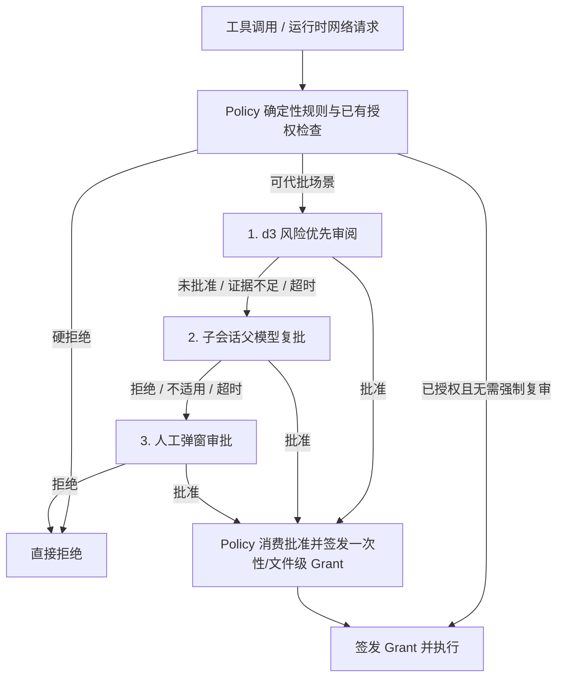
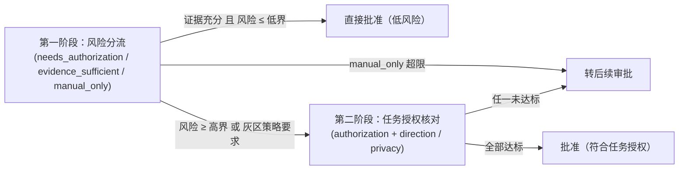

# d3 授权与风险优先审阅

`d3` 是独立于主生成模型的**决策审阅模型**，用于在 `workspace` 权限模式下对需要额外授权的敏感或边界操作进行自动风险评估与代批（Auto-Review）。

**核心边界**：
- 生成模型负责「提出工具调用」，决策模型负责「评估该调用在当前用户意图下是否可安全代批」，核心 `Policy` 负责「确定性规则兜底与最终授权签发」。
- 决策模型不直接执行命令、不修改权限表，也不跨越 `ask` / `unrestricted` / `read_only` / `plan` 的模式硬边界。

## 1. 整体审批链路

当工具调用或运行中网络请求未命中已有授权且未被确定性规则硬拒绝时，进入三级审批链：

- **最小授权消费**：d3 批准的网络连接（当前 `host:port`）、`web_fetch` 单跳 URL 与 MCP 调用**仅单次有效**，不写入会话级通配规则；工作区外普通文件读取仅授予该精确文件的会话读取权。

## 2. 审阅场景与取证策略

系统在请求 d3 前，仅基于**真实用户原话**（不含模型生成的压缩摘要，每条按 Unicode 码点保留前 300 字 + 后 200 字）与**确定性操作事实**（命令文本上限 1,000 字）构造状态证据（State）：

| 审阅场景 | 提交给 d3 的取证材料 | 关键安全约束 |
| --- | --- | --- |
| **普通命令联网**（`command_network`） | 用户原话、命令文本、实际请求连接的 `host:port` | 运行时由回环代理拦截触发 |
| **未修改脚本联网**（`script_basic` / `script_mixed_basic`） | 用户原话、命令、目标脚本路径（注明未修改且未读正文） | 多目标混合命令（`script_mixed_basic`）采用比单脚本更严苛的独立低风险放行阈值 |
| **本会话修改脚本**（`script_diff`） | 用户原话、命令、目标脚本相对 Git HEAD 的单文件 Diff | 只要脚本 mtime 晚于会话启动，即使 host 已放行也**强制复审**；Diff 超 300 行直接转后续审批 |
| **工作区外读取**（`outside_read`） | 用户原话、规范化后的精确文件路径 | 审阅前绝不提前读取待审文件内容 |
| **MCP 工具调用**（`mcp_action`） | 用户原话、MCP 工具名与调用参数 | 风险阶段提前强制校验操作方向，防止远端修改被当作低风险放行 |
| **网页单跳 URL**（`fetch_url`） | 用户原话、当前跳完整 URL | `web_fetch` 每次请求及每次重定向跳转前逐跳审阅 |
| **网页正文扫描**（`web_content`） | URL 与最多 16 KiB 抽样网页正文（头尾 + 前后半区抽样） | 交付模型前独立扫描提示词注入 |

## 3. 两阶段风险优先判定（`risk-first-v2`）

为避免无害的常规辅助操作因「与用户表面措辞不够直接相关」而被误拦，审阅分为两个阶段：

1. **第一阶段（风险分流）**：评估行为是否必须人工介入（`manual_only`）、当前证据是否充分（`evidence_sufficient`）以及额外授权需求程度（`needs_authorization`）。若证据充分且风险极低（`≤ risk_low`），直接放行（MCP 需额外先通过 `direction` 仅限 `fetch`/`send` 的检查）。
2. **第二阶段（授权核对）**：对中高风险操作，核对操作对象、目的地与数据范围是否符合用户明确授权（`authorization`），并按场景附加方向检查（`direction` 唯一最高且为达标的 `fetch` 或 `send`，严禁代批 `modify`）或隐私检查（外部文件 `privacy` 不超上限）。

## 4. 网页注入熔断与人工反馈微调

- **网页注入整轮熔断（`RunReviewGate`）**：`web_fetch` 下载的页面在交给模型前经过 `injection` 维度扫描。一旦检出提示词注入或扫描失败，不仅拦截该次网页正文，还会通过原子单向开关**立即关闭当前根轮次（含所有并发子 Agent）的全部自动代批与父模型复批**，后续所有权限请求强制转交人工审批。
- **版本隔离与单因人工反馈**：阈值配置按模型、端点、问句版本与 Profile 名称严格隔离在 `data/decision.sqlite` 中（`manual_only` 与 `evidence_sufficient` 为不可调硬边界）。仅当审阅链中**有且仅有一个可调授权维度**（`authorization` / `direction` / `privacy`）未达标并转交人工审批时，系统才根据用户的最终批准或拒绝，在预设的严格端与宽松端区间内微调该维度阈值（多项同时未达标时不作调整，防止多因噪声污染基线）。
