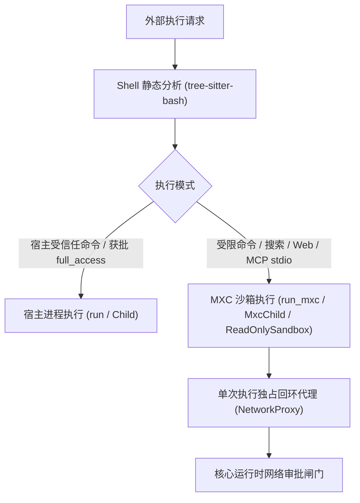

# exec：子进程管理、命令分析与 MXC 沙箱

`exec` 模块（`dagent_exec`）负责外部进程生命周期管理、Bash 命令静态语法/语义分析，以及基于 Microsoft Execution Containers（MXC）的操作系统级沙箱隔离与回环网络代理。

## 1. 架构概览与执行原语

模块提供两套对称的进程执行接口：
1. **一次性阻塞执行（`run` / `run_mxc`）**：在调用线程阻塞运行，实时流式回调未截断输出，返回前确保整个子进程组/进程树、管道与临时目录彻底清理完毕。
2. **长期存活子进程（`Child` / `MxcChild`）**：提供异步按行读取 stdout/stderr 与线程安全写入 stdin 的能力，分别用于宿主侧托管 SearXNG 服务与沙箱内的本地 MCP stdio 服务。

## 2. 宿主子进程隔离与进程组清理

即便是宿主侧执行的子进程，也遵循严格的资源与信号边界：
- **独立会话与无控制终端**：子进程启动时创建独立进程组并脱离控制终端（POSIX `setsid`，Windows 独立进程组 + `KILL_ON_JOB_CLOSE` Job 对象），防止 `sudo`/`ssh` 等程序抢占 TUI 终端键盘。
- **句柄与环境白名单**：除标准流与显式声明的继承句柄外，启动前关闭父进程所有其余文件描述符（如日志文件、数据库连接、网络连接）；按配置过滤敏感环境变量。
- **全路径进程组回收**：超时、外部取消、或主进程退出后后台子进程仍占用管道超过 `drain_after_exit` 时，对**整个进程组 / Job 对象**发送终止信号（SIGTERM → 宽限期 → SIGKILL），杜绝 `server &` 类后台残留进程卡死调用线程。

## 3. Bash 命令静态分析（`analyze`）

在准备阶段使用 `tree-sitter-bash` 对命令脚本进行纯静态 AST 解析，不执行任何展开或外部调用，输出四类核心判定供 `Policy` 决策：

1. **语法与动态性判定**：识别语法错误位置；若包含变量/命令替换、控制流、子 shell、函数或解释器调用，标记为 `dynamic`（静态分析无法穷尽其行为，需依赖沙箱或更高权限模式）。
2. **保守只读白名单与读取路径提取（`is_known_readonly` / `readonly_read_paths`）**：仅当语法合法、无动态结构、无写入重定向，且所有简单命令均属于安全只读子集（如 `ls`/`cat`/`head`/`tail`/`wc`/`grep`/`pwd`/`echo`、工作区内的 `cd`、排除外部执行选项的 `rg`/`find`/`git status|log|diff|show|branch --list`）时，才判定为已知只读，并静态提取命令中的字面量文件路径供核心检查是否涉及工作区外读取。
   > **注意**：由于仓库自身的 `.git/config` 可能包含恶意配置（如 `core.fsmonitor`），核心自动放行已知只读命令时，**依然强制放入 `read_only` 沙箱执行**。
3. **脚本目标与未解析执行分类（`classify_execution`）**：静态识别命令直接调用的脚本路径（`script_targets`，如 `./script.sh`、`python/node/bash script`），并检测是否包含任务运行器或动态执行器（`has_unresolved_execution`，如 `npm`/`make`/`yarn`/`pnpm`/`npx`/`eval`/`source`），供核心决定是走单脚本证据审阅还是完整命令审批。
4. **高危命令硬拦截（`is_dangerous`）**：识别格式化块设备（`mkfs*`/`dd`）、对根目录或 `$HOME` 的 `rm -rf` 及递归改权、关机重启、以及 `curl/wget | sh` 等高危模式，在所有权限模式下直接拒绝。

## 4. 受限执行：MXC 后端

受限命令通过运行时动态加载的 MXC 原生库（`libmxc_ffi.so` / `mxc_ffi.dll`）执行，无需 Node 或外部桥接进程。

### 4.1 原生库与 C ABI
MXC 原生库由 `dagent runtime sync` 按平台下载到 `runtime/mxc/`。后端启动时动态加载并严格校验原生库 ABI 版本（`kMxcVersion = 1.0.1`）、策略 JSON 契约版本（`kMxcPolicyVersion = 1.0.0`）与导出符号。由于 Linux 下 `bubblewrap` 的 `--die-with-parent` 绑定在**创建它的系统线程**上，沙箱实例统一由与子进程相同生命周期的 stdout 读取线程发起创建，防止短命连接线程退出时误杀 MCP 等长期子进程。

### 4.2 文件系统与环境变量隔离策略（`mxc_policy`）
`exec::mxc_policy` 将核心授权（`Grant`）编译为 MXC 策略：
- **默认拒绝一切与私有环境重定向**：Linux `bubblewrap` 后端仅只读挂载系统基础运行库与 `/etc` DNS 配置，创建全新的私有 tmpfs `/tmp` 与每次执行独占的私有 `HOME`（`/tmp/dagent-home-XXXXXX`），并将 `HOME`、`XDG_*`、`TMPDIR`、`UV_CACHE_DIR`、`NPM_CONFIG_CACHE` 全部重定向至该私有目录；宿主 `$HOME`、`/var`、`/opt` 等默认不可见（Windows `ProcessContainer` 则强制设置 `allowDaclMutation=false` 防止容器篡改宿主 ACL）。
- **按需叠加读写挂载**：按授权范围挂载只读路径（`readonlyPaths`）与可写路径（`readwritePaths`，`read_only` 模式下为空）。
- **受保护与敏感路径屏蔽**：
  - **禁止读取（`deniedPaths`）**：Home 下的控制面目录（`config/`、`data/`、`logs/`、`run/`、`memory/`）以及工作区内的敏感文件（`.env*`、`*.pem`、`*.key`、`id_rsa*`、`.ssh`、`.gnupg`）除非获得显式单次读取豁免，否则一律屏蔽（文件拒绝访问，目录挂载为空 tmpfs）。
  - **禁止写入（嵌套只读）**：可写工作区内的 `.git`、受保护目录与敏感文件被追加为嵌套只读挂载，写入直接返回 `EROFS`。

### 4.3 网络隔离与回环 HTTP 代理（`NetworkProxy`）
沙箱网络仅有两种姿态：
1. **完全无网络**：只读搜索（`ReadOnlySandbox`）与未配置网络目标的 MCP stdio 直接启用 `--unshare-net`，仅保留沙箱内部回环。
2. **受控代理模式**：受限 `bash`、`web` 工具与带网络白名单的 MCP stdio 启动时：
   - 宿主为本次执行启动独占的 `NetworkProxy`（监听 `127.0.0.1:<随机端口>`）。
   - MXC 为沙箱建立独立网络命名空间（`slirp4netns` + `iptables` 默认 DROP），**仅放行通往宿主回环代理端口的流量**，并自动注入 `HTTP(S)_PROXY` 环境变量；任何绕过代理的直连或 DNS 请求均被内核防火墙丢弃。
   - 代理拦截 `CONNECT host:port` 与明文 HTTP 请求，校验连接发起者属于当前系统用户后，以 `host:port` 为键回调核心的网络审批闸门（支持同目标并发去重、单次执行提问次数上限与审批超时控制）。
   - 获批后由宿主代理解析域名并建立远端连接；若用户在运行中拒绝或撤销网络授权，代理立即返回 `403` 并通知执行层终止沙箱进程。

### 4.4 装配、能力快照与探测
后端启动（交互模式与 `run` 模式）时自动执行两阶段真实沙箱探针（`sandbox_probe`）：
1. **文件系统探针（`filesystem`）**：验证 MXC 库、命名空间与私有 HOME 读写。
2. **网络隔离探针（`network`）**：验证 `slirp4netns`、命名空间内防火墙与代理链路。

若宿主缺失前置组件、受 AppArmor 限制未加载配置、或平台容器探针失败（可通过 `dagent sandbox status` 诊断），系统按**失败关闭（Fail-Closed）**原则将沙箱标记为不可用，自动禁用 `workspace` 权限档与 `web` 工具，绝不静默降级为无保护的宿主执行（详见 [agent §5](agent.md#启动自检未找到可用沙箱时)）。
