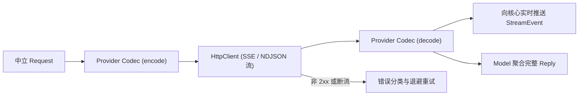
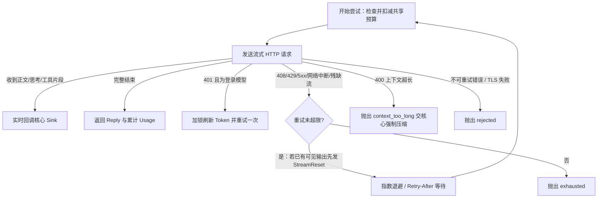

# llm：模型客户端、协议编解码与登录凭据

`llm` 模块（`dagent_llm`）实现核心层定义的模型端口（`ModelSession` 与 `DecisionModel`），负责将核心层的中立请求转换为各模型厂商的 HTTP/流式协议，并处理流式增量聚合、自动退避重试、错误分类与 OAuth 设备登录。

## 1. 接口与边界

核心层只感知中立的 `Request`、`StreamEvent` 与 `Reply`，不接触任何厂商字段、URL 或鉴权密钥：

- **凭据隔离**：含 `api_key`、自定义 `headers` 与凭据路径的 `ProviderConfig` 仅保留在装配层与 `llm` 内部；向前端和会话状态暴露的 `PublicModel` 仅包含模型名称、上下文窗口与认证来源类型（`key` / `login:opencode` / 空）。
- **自定义请求头（`headers`）**：加载时展开 `${ENV}`，每次请求编码时将 `{session_id}` 替换为当前所属会话 ID。所有动态展开后的密钥与请求头值在进入错误摘要、日志或会话记录前均会被强制脱敏。

## 2. 协议适配（Codec）

每次模型尝试创建独立的 `Codec` 实例，将厂商差异收敛在编解码层：

| 协议类型（`kind`） | 传输分帧 | 关键协议适配规则 |
| --- | --- | --- |
| `openai-chat` | SSE | `POST /chat/completions`；按 `index` 聚合分片工具调用，识别 `reasoning_content` / `reasoning`；输出上限映射为 `max_completion_tokens` |
| `ollama` | NDJSON | `POST /api/chat`；为无 ID 的工具调用生成请求内唯一标识并按序回传；显式传入 `options.num_ctx` 与 `num_predict` |
| `anthropic` | SSE | `POST /messages`；顶层独立传递 `system`，将工具调用与结果分别转换为 `tool_use` 与合并的 `tool_result` |
| `systemone`（d3） | JSON | 独立的 `DecisionModel` 端口（直接向配置的完整 `endpoint` 发送 POST 请求）；编码审阅上下文与 `noul`/`choice` 问题，解析各维度概率得分 |

*(注：若厂商或兼容网关返回的 `ToolCall` 缺失 ID 或出现重复 ID，`Model` 会自动基于会话内递增序号补全或追加唯一后缀 `call_<serial>_<seq>`，保证下游状态机与历史不变式稳定。)*

## 3. 一次完整调用与重试策略

`Model::complete` 在调用线程上驱动流式请求，并通过 `ModelAttemptHooks` 与核心层共享本轮调用次数及 Token 预算：

- **默认重试与退避**：默认最多重试 2 次（共 3 次尝试），采用 1s 起步、上限 30s 的带抖动指数退避；若服务端返回合法的 `Retry-After`（≤300s）则优先遵循。
- **可见流重置（`StreamReset`）**：若失败的尝试已经产生过部分正文或思考，`Model` 在触发 `on_retry` 回调时标记 `had_output = true`，由核心 `TurnRunner` 向前端发送 `StreamReset` 清空作废内容，绝不将半截失败内容写入历史。

## 4. 设备登录与凭据管理

针对支持 OAuth 设备码授权的提供方（如 `opencode`），内置 RFC 8628 登录与令牌自动续期流程：

1. **设备码授权**：前端发起登录时，请求设备码并返回验证链接与用户码，随后轮询令牌端点直至用户批准、过期或取消。
2. **安全凭据存储**：凭据保存在 `<home>/data/credentials/<provider>.json`，强制校验目录（`0700`）与文件（`0600` / Windows 私有 DACL）权限，拒绝任何符号链接或重定向点，采用同目录临时文件 + `fsync` + 原子替换写入。
3. **跨进程并发刷新**：推理前若发现 Token 距过期不足 5 分钟或请求收到 HTTP 401，获取 `run/credentials/<provider>.lock` 文件锁后重读文件；若其他进程已完成刷新则直接复用新令牌，否则写入 `refresh_pending` 状态并执行刷新。
