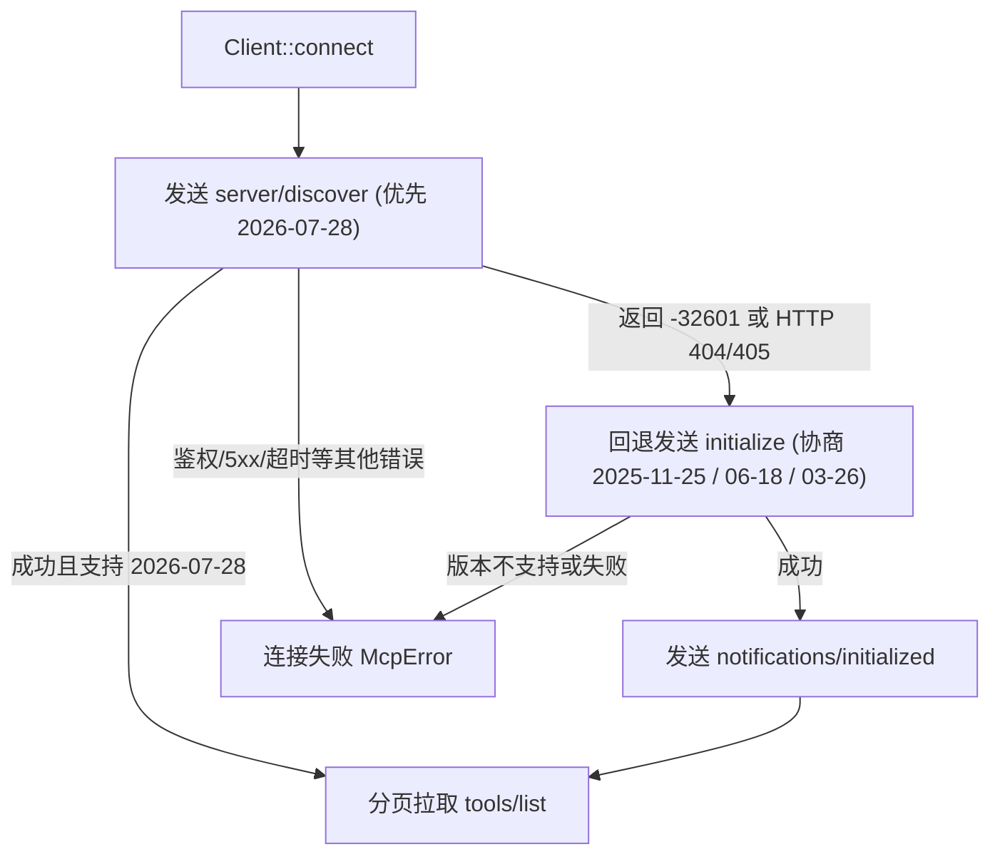

# mcp：MCP 客户端与传输层

`mcp` 模块（`dagent_mcp`）实现 Model Context Protocol 客户端，负责连接外部 MCP Server、协商协议版本、发现工具列表并执行工具调用。

**职责边界**：
- 一个 `mcp::Client` 实例对应一个 MCP Server 连接。
- 后台并发连接管理、主会话步骤边界的等待/重连、以及将 MCP 工具包装进核心工具注册表由上层 `tools::McpHub` 负责（见 [agent §8](agent.md#8-mcp-生命周期) 与 [tools](tools.md)）。
- 当前仅实现 `tools` 能力（`tools/list` 与 `tools/call`），不实现 resources、prompts、sampling 或服务端推送通知。

## 1. 协议版本协商与握手

连接建立时采用「现代无状态发现优先，旧版初始化握手回退」的策略：

- **现代协议（`2026-07-28`）**：无会话状态，每个请求在 `params._meta` 中携带协议版本与客户端信息；HTTP 传输额外附带 `Mcp-Method`、`Mcp-Name` 及按工具 Schema `x-mcp-header` 注解提取的 `Mcp-Param-*` 路由头（若单个工具的 `x-mcp-header` 注解不合规，仅跳过该工具并记录告警，不影响同服务其他工具注册；`tools/list` 分页拉取最多保护 100 页并检测游标死循环）。
- **旧版协议（`2025-11-25` / `2025-06-18` / `2025-03-26`）**：通过 `initialize` 握手协商版本；HTTP 传输保存服务端返回的可选 `Mcp-Session-Id`，后续请求携带该会话头，连接关闭时发送 `HTTP DELETE` 释放远端会话。

## 2. 两种传输方式

### stdio（本地沙箱子进程）
1. **强制显式权限 Profile**：`config/mcp.json` 中的每个 stdio server 必须显式配置 `permissions.{read, write, network}`。缺少权限配置或当前平台无可用沙箱时直接拒绝启动，绝不在宿主环境裸跑 MCP 进程。
2. **长期受限子进程（`MxcChild`）**：在 MXC 沙箱内启动长生命周期子进程，使用受管环境（`managed` 或独立的 `mcp/<name>` 依赖环境）与每连接私有的临时 `HOME`/`TMPDIR`。
3. **严格网络白名单**：stdio 沙箱的网络仅放行其 `permissions.network` 显式列出的 `host:port`（经回环代理静态匹配），不支持运行中弹窗审批未知域名。
4. **全双工消息分发**：stdin/stdout 按行传输 JSON-RPC；调用线程登记请求 ID 后写入 stdin，独立读取线程按响应 ID 唤醒对应等待方。超时或取消时向服务端发送 `notifications/cancelled`。

### Streamable HTTP（远程服务）
1. **每请求独立连接**：每次 RPC 调用使用独立的 `HttpClient` 发送 POST 请求，支持整包 JSON 或 SSE 流式响应（收到匹配请求 ID 的响应后立即关闭流）。
2. **安全约束**：连接目标必须同时在 server 的 `permissions.network` 中显式列出；严禁跟随 HTTP 重定向（`3xx` 直接报错），防止鉴权头泄露到未知主机。
3. **边界标识**：审计与 UI 将本地沙箱运行的 stdio 标记为 `mxc`，将远程 HTTP 服务标记为 `remote`。

## 3. 工具命名、错误分类与 McpHub 生命周期

- **限定工具名**：发现的工具统一命名为 `mcp__<server>__<tool>`（非法字符替换为 `_`，超过 64 字符或重名项自动跳过）。
- **错误与业务结果区分**：工具返回 `isError: true` 属于正常的业务执行结果，原样交给模型；底层故障则抛出分类的 `McpError`（`spawn` / `handshake` / `timeout` / `cancelled` / `rpc` / `protocol` / `disconnected`）。
- **`McpHub` 编排闭环**：后端启动时由独立线程并发发起所有 Server 连接；主会话在每步推理前（`wait_connecting`）等待正在连接或重连的实例就绪（受 `connect_timeout` 限制），避免步骤间工具列表抖动；运行中遇到 `disconnected` 时在下一步边界自动执行且仅执行一次重连；当会话权限被撤销时立即调用 `shutdown()` 终止连接并阻断在途调用。
