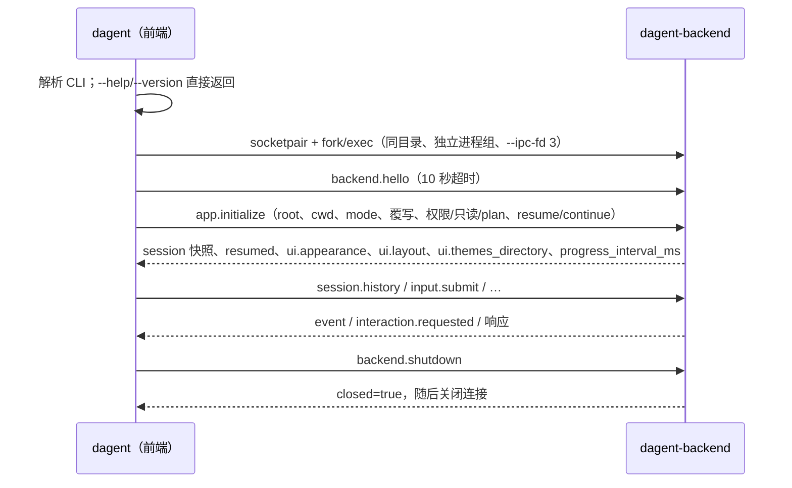

# protocol：前后端进程与私有协议

`dagent` 是前端进程，负责命令行、终端界面和输出格式；每个前端启动一个只属于自己的 `dagent-backend`，后端读取配置、
执行模型与工具、写会话记录。两者经私有连接（Linux socketpair、Windows 预连接命名管道）上的 JSON-RPC 2.0 通信。本文描述相关的四个模块：

| 模块 / 库 | 头文件 | 职责 |
| --- | --- | --- |
| `protocol` / `dagent_protocol` | `protocol/rpc.hpp`、`protocol/dto.hpp` | JSON-RPC 编解码、固定错误码与业务错误 kind；纯数据 DTO；只依赖 base |
| `ipc` / `dagent_ipc` | `ipc/channel.hpp` | socketpair 端点、LF 分帧与短写、后端进程启动/宽限回收 |
| `client` / `dagent_client` | `client/client.hpp` | 前端 RPC：请求 id 匹配、同步/异步调用、事件与交互转交、连接结束一次性失败 |
| `backend` / `dagent_backend` | `backend/backend.hpp`、`publisher.hpp`、`convert.hpp` | 后端 RPC 方法分发、核心值 → DTO 转换、单一有序发送队列；依赖 runtime/protocol/ipc/base |

后端可执行入口在 `app/backend_main.cpp`：它把 `app::assemble_backend` 作为 `backend::Assembler` 注入 `backend::Backend`，
因此 backend 库不包含任何 app 头。会话控制见 [runtime](runtime.md)。

装配输入、结果、配置错误及回调契约位于 `backend/assembly.hpp`。
`Assembled::configuration` 直接持有 `backend::ConfigurationGateway`，无需运行时向下转换；
该端口在 `backend/configuration.hpp` 中扩展 runtime 的模型操作，提供主题路径与外观能力。
查询与历史读取契约位于 `backend/queries.hpp`，登录契约位于 `backend/login.hpp`。

这是现有功能的进程间适配：没有监听 socket、共享后端、发现文件、自动重连、事件补发或后台继续执行。

## 1. 进程与传输



- `spawn_backend` 通过 `base::executable_path(error_code&)` 在前端真实可执行文件同目录找 `dagent-backend`，不随 `DAGENT_HOME` 改变；先关闭父端再 `dup2` 到 fd 3 并清除 CLOEXEC，其余 FD 用 `close_range` 关闭；
  不经 shell，argv 不带密钥或提示词。后端启动后把 IPC FD 设回 CLOEXEC，工具和 MCP 子进程不会继承它。
- 后端新建独立进程组，终端 SIGINT 只由前端转成取消请求，不广播到其他后端。
- 一行一个完整 JSON 对象（UTF-8 JSON Lines），读取处理半帧/多帧，写入处理短写；不支持 batch。
- socket EOF 表示前端结束：后端走与 `backend.shutdown` 相同的清理入口，清队列、取消执行、同步记录后退出。
- 前端拥有后端 PID：正常退出等待 10 秒宽限，超时 SIGTERM/SIGKILL 自己创建的后端。后端意外退出时前端报告
  `the backend connection was closed`，不自动拉起新后端、不重发输入。

`ipc/channel.cpp` 保留分帧、长度限制、缓冲和错误状态；`ipc/channel_posix.cpp`
实现连接 I/O、描述符继承、后端路径查找、进程启动与回收。公共头不暴露 fd 或 pid_t，平台文件由 `DAGENT_PLATFORM` 选择。
每次底层 send/recv 返回字节数、中断、关闭或失败的中立结果，共享循环仍按原位置重试 EINTR；
send 保留 MSG_NOSIGNAL，recv 保留原 flags，长度检查与 EOF 时的缓冲处理不变。

后端参数遍历仍在 `app/backend_main.cpp`。`InheritedEndpoint::parse_argument` 保留 atoi 语义，重复
`--ipc-fd` 最后一次生效；参数对象只持有解析结果，替换或销毁它不会关闭端点。校验通过后先执行
`initialize_backend_signals`，再 `Channel::adopt` 接管端点，最后 `prevent_inheritance` 设置 CLOEXEC。
usage、退出码和 `--ipc-fd <fd>` 参数格式不变。

`Channel` 移动后源连接失效，移动赋值先关闭目标旧连接；close 不清空缓冲、错误和 EOF 状态。
`BackendProcess` 析构只关闭 channel，不 wait/kill。它的移动保留原默认移动复制 PID 的语义：
共享不透明的只读进程标识，各对象独立记录是否已回收，移动后的源对象仍保留原进程标识；
回收一个对象不会更改另一个对象的记录。移动赋值不回收目标原来的进程。
`wait_or_terminate` 仍以 20ms 间隔等待，宽限到期后发 SIGTERM，等待 200ms 后按原条件 SIGKILL/waitpid。

上述 fork、fd 及信号步骤为 Linux 实现。Windows 的 `channel_win.cpp` 使用当前用户专属 DACL、
128 位随机名称和 PIPE_REJECT_REMOTE_CLIENTS 的双向字节管道，父进程预先完成两端连接。
读写分别持有 OVERLAPPED/事件，底层同步方法等待完成。shutdown 阻止新 I/O，取消并等待在途操作，
随后关闭管道句柄使对端收到 EOF；不会在取消尚未完成时释放调用方缓冲区，close 保持幂等。

Windows 找同目录的 `dagent-backend.exe`；CreateProcessW 的显式继承清单只包含 stdio 副本和子端管道。
`--ipc-fd` 值为十进制 uintptr_t，严格拒绝无效文本和溢出；解析不接管端点，adopt 后清除继承位。
后端挂起创建并加入生命周期 Job 后恢复；Job 加入失败即启动失败。父进程关闭其子端副本，不保留多余的写端。
共享后端状态拥有进程句柄及 KILL_ON_JOB_CLOSE Job，最后一个状态销毁或前端被终止都会清理后端及后代。
宽限回收先断开管道并等待，超时 TerminateJobObject 并等待后端退出；强制终止返回 false。
后端屏蔽 Ctrl-C/Ctrl-Break 的控制台处理，取消只由前端通过 IPC 发出。没有全局监听端点或重连通道。

只有后端读取 models.json、凭据、提示词和业务配置；前端只读取初始化返回的主题文件路径指向的 UI 主题。

## 2. 身份与版本

业务协议版本 major=1、minor=4（与 JSON-RPC 的 `jsonrpc:"2.0"` 分开），两端不等直接返回 `version_mismatch`。

| 身份 | 作用 |
| --- | --- |
| request id | 一次连接内的请求匹配；不作持久去重，有副作用的请求不重试 |
| session_id | 持久会话 ID |
| session_generation | new/resume/切模型成功后递增；会话修改请求必须携带当前值，迟到请求得到 `stale_session` |
| input_id / run_id / interaction_id | 后端实例内的队列输入、一次 turn/compact、一次待回答交互 |
| event seq | 本连接已发布事件的递增序号，与 SQLite `events.seq` 无关 |
| model_call_id | 模型原有的 tool_call id，写记录和兼容 JSONL 时保持 |

## 3. 请求方法

会话修改请求带 `{session_id, session_generation}`（SessionTarget）。只读查询明确目标 session_id，可以查询历史子会话。

| 方法 | 执行位置 | 结果 |
| --- | --- | --- |
| `backend.hello` | 读线程 | 协议版本、后端版本、backend_instance_id |
| `app.initialize` | 命令线程，只允许一次 | mode、session 快照或 null（查询模式）、resumed、`ui.theme_file`、`ui.appearance`、`ui.layout`、`ui.themes_directory`、progress_interval_ms；维护模式返回 `{maintenance: ...}` |
| `backend.shutdown` | 读线程 | 实际收尾后返回 closed=true；重复关闭幂等 |
| `session.snapshot` | 读线程 | SessionSnapshot |
| `input.submit` / `input.recall_last` | 读线程 | input_id（仅表示入队）/ 取回的最后一条排队输入或 null |
| `run.cancel` | 读线程 | cancel_requested 或 already_finished；不是运行终态 |
| `interaction.answer` | 读线程 | accepted；已关闭返回 `interaction_closed` |
| `session.cycle_permission` / `set_permission` / `toggle_planning` / `grants` | 读线程 | 生效后的快照 / 授权列表 |
| `session.revoke_grant` | 读线程校验后走即时控制路径 | 提交撤销记录、终止使用旧授权的活跃执行后返回 removed（运行中也可用） |
| `model.list` | 读线程 | 公开模型、provider 种类、default_name、selected_name |
| `session.new` / `resume` / `select_model`、`model.add`、`session.compact` | 命令线程 | 成功返回快照；`model.add` 返回 model/selected/selection_error；compact 返回 operation_id，完成走 `operation.finished` |
| `ui.appearance.save` | 命令线程 | `{appearance, layout?}`：联合校验、原子保存后返回生效的 appearance；失败为 config_error |
| `workspace.git_status` | 查询线程 | `{repository, branch, ahead, behind, files:[{path,status,added,removed}]}`，当前项目根的本地 Git 状态 |
| `agents.list` | 查询线程 | `[{name,description,permission,tools}]`，配置的可用 Agent 定义 |
| `memory.list` / `memory.view` / `memory.delete` | 查询线程 | 全局与当前项目条目元数据 / 正文 / 删除结果；详见 [memory](memory.md#5-用户管理) |
| `session.list` / `children` / `history` / `history_close`、`workspace.info` / `complete` | 查询线程 | 会话列表、子会话、HistoryItem 页与游标、项目信息、文件候选 |

读线程只做校验与即时操作，不会被模型调用阻塞；耗时命令与只读查询各有一个工作线程，查询失败不影响执行中的 Run。
请求字段类型不匹配返回 `invalid_params`（-32602），不会终止后端连接。

Backend 使用静态路由表关联方法名、执行通道与成员处理函数。`dispatch` 只查表一次，
命令和查询的 `Job` 携带已解析的处理函数，工作线程不再按方法名分派。
命令线程仅允许初始化处理函数在 `initialized_` 为 false 时执行，其余命令仍返回原启动错误。
各通道保留原异常映射；业务错误统一通过内部 `business_error` 构造。
provider 路由在读线程先共用参数校验，保持原字段校验及错误覆盖顺序；
`provider.logout` 校验成功后先取消待登录操作，再进入查询队列。

### 登录与提供方模型（协议 minor 4，阶段 3a）

所有提供方方法都要求 `provider: "opencode"`。仅公开状态、链接和模型元数据；device_code、token、头值不返回前端。
`app.initialize` 新增 mode=login：不读 models.json/config.json，不建会话或工具环境，返回 `{mode:"login",session:null}`。
普通 interactive/run/models/sessions 装配同样提供登录网关。

| 方法 | 参数（除 provider） | 结果 | 执行位置 |
| --- | --- | --- | --- |
| `provider.login.start` | 无 | `{login_id,provider,verification_url,user_code,expires_at,subscription_url}` | 查询线程；只取设备码，不轮询 |
| `provider.login.wait` | `login_id` | `{provider,state,workspace,expires_at}`，成功 state=signed_in | 查询线程；等待批准并保存凭据 |
| `provider.login.cancel` | `login_id` | `{cancelled:bool}`，未知/已结束 ID 为 false | 读线程；请求取消轮询和等待 |
| `provider.status` | 无 | `{provider,state,workspace?,expires_at?}` | 读线程；纯本地读取，不刷新、不联网 |
| `provider.logout` | 无 | `{provider,state:"signed_out"}` | 查询线程；先在读线程取消本后端的待登录操作 |
| `provider.models.list` | `refresh?:bool=false` | `{provider,models,cache_age_seconds,stale}` | 查询线程 |
| `provider.model.add` | `model_id`（完整 opencode-go/<model>）与 SessionTarget | `{model,selected,selection_error}` | 命令线程；原子保存后交 runtime 切换 |

所有 expires_at 使用 Unix 秒。状态为 signed_out / signed_in / needs_sign_in；过期、refresh_pending 或损坏内容为 needs_sign_in。
workspace 是 org_id。模型清单行包含 `id,model,name,kind,base_url,context_window,max_tokens,send_reasoning_content,cost,
available,unavailable_reason,added`；cost 保留 models.dev 的公开价格字段，input/output 单位为美元/百万 token，零价格可显示 free。
cache_age_seconds 为缓存下载后的秒数；stale 表示刷新失败回退或缓存已超过 24 小时。
Anthropic 行 available=false；地址超出允许范围的模型不返回。

start 返回的 login_id 仅在当前后端有效，同时最多一个待登录操作；失败后可重新 start。
wait 可阻塞至授权期限，取消用独立 cancel 请求，关闭连接同样取消；取消和失败返回 query_failed，文案不含 OAuth 原文。
缺参/错类型返回 invalid_params；本地存储不安全、网络/授权失败为 query_failed。status 可在 wait 期间查询。
model.add 的 SessionTarget 必须有效；保存失败为 config_error。保存成功但切换忙碌/失败时，selected=false、selection_error
说明原因，已保存条目保留，可随后 session.select_model。成功切换沿用 session.changed 与 generation 更新。
已存在模型不覆盖且不依赖公共清单下载。清单 added 按磁盘 models.json 计算，model.list 同样读取当前配置。
公开模型 DTO 包含 auth（key / login:opencode / 空），保留 has_key 供旧界面使用；
另有 send_reasoning_content 布尔值（默认 false），供 TUI 对支持此选项的 kind 显示 reasoning 开关，不含内部 headers/凭据。

### 外观初始化与保存（协议 minor 3）

initialize 的 `ui.appearance` 是补齐默认值的外观对象：theme 为已解析的绝对主题文件路径，
mode/background/panels/density/icons/diff/links/accent 均为有效配置值。旧 sidebar 仅兼容读取，布局使用补齐默认值的 `ui.layout`。
`ui.themes_directory` 是 Home/themes 的绝对路径，用于前端切换预设；旧 `ui.theme_file` 字段保留。
前端在第一帧前应用这个对象。字段的合法取值见 [UI](ui.md#2-外观与设置)。

```json
{"method":"ui.appearance.save","params":{"appearance":{
  "theme":"dagent","mode":"auto","background":"transparent",
  "panels":"filled","density":"comfortable","icons":"unicode"
},"layout":{"width":"auto","navigator":"auto","status_panel":"right",
"navigator_sections":["sessions","git","skills","agents"],
"status_sections":["session","context","plan","changed","running_agents","mcp"]}}}
```

方法无需 SessionTarget，运行中也可保存；仅作用于当前后端的 Home。
后端持配置写锁，重新读取 config.json、保留其它键、更新 ui.appearance 和可选 ui.layout，沿用模型添加的
workspace::write_text 原子写与文件 stamp 检查；内存生效值只在写入成功后更新。
成功返回 `{"appearance": {...}}`，theme 解析为绝对路径；校验和 I/O 失败返回业务错误 config_error，
不关闭连接。前端收到成功后关闭设置并显示 Settings saved；失败保留对话框。
其它已打开的前端不会被广播更新，下一次启动读取保存值。

保存使用 ordered_json 并局部替换原文：保留原有键顺序与未修改字段的格式，新键追加到对象末尾。
appearance / layout 中缺失且等于默认值的键不补写；修改原有行内数组时保持一行，元素间使用逗号加空格。
传入 layout 时同步移除旧 appearance.sidebar，未传入时保持旧保存调用兼容。model.add 与 provider.model.add 同样保序写 models.json。

### 宽布局查询与工作区通知

`workspace.git_status` 可带当前 `session_id`（与 workspace.info 一样，查询本后端固定的项目根）；不要求 SessionTarget，不联网。
`repository` 为布尔值；非仓库为 false，branch 为空、ahead/behind 为 0、files 为空。
branch 是分支名，detached HEAD 使用短 SHA；ahead/behind 使用本地 upstream 信息，不 fetch。
files 的 path 相对项目根，status 归一化为 M / A / D / ?：未跟踪为 ?；XY 中含 `D` 记为 D、含 `A` 记为 A，其余含改动或冲突的条目记为 M。added/removed 来自暂存与未暂存 numstat 的合计，
二进制或 untracked 没有 numstat 时为 0。使用 managed git 只读沙箱，禁用 hooks/fsmonitor/外部 diff/textconv；
每条命令 2 秒、每路输出 1 MiB，只解析完整 NUL 记录，最多返回 2048 个文件，超出时返回有界前缀。

`agents.list` 无参数，直接返回数组；permission 为 inherit / read_only / ask，tools 为字符串数组或 null（继承工具集）。
仅返回配置定义的 name、description、permission、tools，不返回提示词或凭据；定义在后端启动时加载。

交互模式新增事件 `workspace.changed`，无会话身份/generation 依赖，用于提示重查当前工作区。
应用层 inotify 有界监听（最多 4096 目录），前端收到后用 120ms 防抖调用 workspace.git_status。
监听实现在 `app/queries_posix.cpp`，目录保护条件留在共享 `QueryGatewayImpl::should_watch_directory`。
该通知不携带文件内容，不改变会话/执行状态；轮次和工具完成事件仍是刷新来源。

`session.history` 首次调用捕获高水位，返回不透明游标；每页最多扫描 `session.history_scan_limit` 条记录（随附值 100），读完、`history_close` 或连接关闭时释放，
每页分配连接内唯一、单次消费且绑定 session_id 的游标。跨会话、已消费或已释放游标返回 `invalid_state`。历史查询不取写锁、不恢复会话、不构造模型或 MCP（记录路线 L22）。

历史条目新增 `kind=permission/parent_review/auto_review`：`text` 为审批来源、终态、范围和理由，`audit` 保留完整审批记录。
`permission` 属于实际请求的子会话（或直接操作的主会话），`parent_review` 属于作出审阅的父会话；只有父记录的顶层
`usage` 计入审阅归属，子记录中的审阅 usage 仅作关联证据。旧条目没有 `audit` 时按 null 读取。
`audit.estimated_budget_tokens` 记录服务端未报告用量时的审阅预算估算；它影响运行中的共享 token 上限，但不加入实测 `usage`。

## 4. 事件与快照

通知方法为 `event`，信封字段：seq、session_id、session_generation、kind、data，以及可选的 parent_session_id、model_call_id、agent。子 Agent 事件在后端展平身份，不再嵌套。

| kind | 来源 |
| --- | --- |
| `turn_started` `step_started` `text` `reasoning` `stream_reset` `retrying` | 核心执行事件 |
| `tool_pending` `tool_started` `tool_output` `tool_finished` | 工具事件；data 与原实时 JSON 形状一致，工具展示数据保持 View JSON |
| `context` `compacted` `model_changed` `mode_changed` `notice` `auto_review` `turn_ended` | 核心状态变化 |
| `workspace.changed` | 工作区文件或 Git 元数据变化；无会话身份，提示前端防抖重查 |
| `session.changed` | new/resume/切模型安装完成；data 为 replace_transcript、resumed，前端随后用 `session.snapshot` 取权威状态 |
| `operation.finished` | 手动压缩结束 |
| `interaction.requested` / `interaction.closed` | 审批/问答的激活（data 为 InteractionRequest：`interaction_id`、`kind`、`payload` 及会话身份）与关闭 |

`session.compact` 在任务可执行前登记 operation_id，并通过接受屏障保证成功响应先于该任务的事件入发送队列。
`operation.finished.data.operation_id` 与接受响应一致，即使空历史压缩立即完成，前端也会先进入压缩状态再退出。

Publisher 在捕获快照前后比较已发布 seq，并在同一短锁边界分配序号与入队；事件有 seq，快照带 state_seq。
前端拒绝旧 generation 或低于已应用状态水位的快照；已被快照覆盖的状态事件不再覆盖快照。
快照不包含正文，正文/工具展示仍按顺序投影到所属会话文档，与当前选中的页面无关。
context 显式携带 used/limit/window/trigger_percent；删除空的 phase、children、context.usage 与未使用事件身份字段。
快照还携带 `sandbox_available`（默认 true）与 `sandbox_missing`（默认空数组），前端据此隐藏 workspace 并提示原因。

`tool_output` 的原始字节可能截断 UTF-8 字符：backend 按调用 id 暂存不完整的尾部字节，在 JSON 编码前与下一块拼接，
`tool_finished` 前补发剩余部分。

`tool_started.data` 增加当前调用的 `execution_id`、`authority=user/parent_model/decision_model` 与 `approval` 身份对象。审批身份包括 `request_id`、父/子
`session_id`、`origin_call_id`、`call_id`、`execution_id` 及父/子权限 revision；实际 backend、sandbox 与授权范围仍由
同一事件报告。审批交互载荷使用相同字段，身份对象名称为 `identity`。这些字段供关联审计，不构成可恢复的授权。
会话授权复用时 `approval` 保留原始批准来源，当前工具由顶层 `id/execution_id` 标识；旧记录缺少 execution_id 时读为空。
`audit.explicit_denial` 区分明确拒绝与审阅失败；仅明确网络拒绝可保存为会话拒绝规则。
MXC 执行期间经回环代理放行的目标会补入最终 bash / web 结果的 `view.network_targets`；需要审批的批准来源见对应 permission 的 actual_grant。
配置、当前模式或托管端点直接放行时没有额外审批记录。

web 工具沿用 `tool_started/tool_finished` 事件，`tool_finished.data.view.kind` 为 `web`。`operation` 区分 search/fetch，
视图包含 query、url、title、content_type、output、status、offset、next_offset、total_bytes、cached、truncated、network_targets 和 elapsed_ms。
网页正文随工具完成事件返回，不经 `tool_output` 流式投递；视图字段和历史格式见 [tools](tools.md#4-界面数据view)。

父审阅通过 `notice` 显示 `Reviewing subagent permission`，不创建 `interaction.requested` 模态交互。
审批结果 Notice 增加可选 `persistent=true`，前端把它保留在正文；缺省为 false。历史审批条目投影为同类持久提示，
不会重新提交审批或恢复授权。unrestricted 的说明是“may delegate permission reviews to the parent model”，实际路由还受
Home 中 `subagents.approval.mode` 和当前父权限约束。

## 5. 背压与发送

所有输出经一个有序发送队列，由单一发送线程写 socket。队列软上限 8 MiB：生产者在锁外等待容量，关闭时被唤醒并放弃投递；
超过上限的单条消息只在队列空时单独发送。RPC 响应与错误走控制通道直接入队，不等待容量，保证取消/关闭不被慢消费者阻塞。
快照响应在等待容量后才取值，若其间有新事件入队则重取，避免旧快照携带新 state_seq。

## 6. 错误

JSON-RPC 标准错误使用标准码（-32700/-32600/-32601/-32602/-32603）。业务错误 code=-32000，`data.kind` 固定为
busy、stale_session、not_found、session_in_use、interaction_closed、invalid_state、config_error、query_failed、startup_failed、
version_mismatch、closing；前端只按 kind 分支，不解析文案。模型/工具失败属于 Run 结果或 ToolResult，不包装成 RPC 错误。

前端退出码：成功 0，参数/配置错误 2（包括后端返回的 `config_error`），执行/启动/通信失败 1，中断 130。

## 7. 前端使用方式

- **交互**：`app::BackendSession` 启动后端并完成握手，`ui::run_interactive` 只持 `client::Client`、初始化快照与页面状态，
  业务命令都发 RPC（见 [ui](ui.md)）。`FrontendBridge` 把读线程上的事件/交互 post 到渲染线程。
- **run**：`app::run_backend` 以 mode=run 初始化，通过 `input.submit` 提交提示词，消费事件直到本 Run 的
  `turn_ended`（子 Agent 的结束事件不结束父 run），再 shutdown。`RunOutput` 累积主会话的 text/json 结果；
  jsonl 直接输出协议事件信封，保留展平的子身份及会话/操作通知，不另发首条 session 行，也不还原 `sub_event` 包装（见 [app](app.md#6-run-输出)）。
- **sessions / --list-models**：以查询模式初始化（不创建会话、不启动 MCP、不收集 git 环境），调用 `session.list` / `model.list` 后退出。

## Skill queries

`skills.list` is a read-only query returning `skills: [{name, description, path}]` and `diagnostics: [{path, message}]`. `input.submit` remains text-only. Tool presentation adds `kind: "skill"` with `name` and `path`. See [skills](skills.md).

## 记忆管理

`memory.list` 不带参数，返回 `entries: [{scope, name, type, updated, description}]`。
`memory.view` 与 `memory.delete` 接收 `{scope, name}`，返回 `view: {kind: "memory", op, scope, name, type, updated, description, content}`。
它们作用于后端当前 Home 和项目，不要求 SessionTarget；delete 是用户管理操作，不重试有副作用的请求。
memory 工具的 `tool_finished` 和历史 tool 条目使用相同 MemoryView JSON，run JSONL 沿用事件信封。
