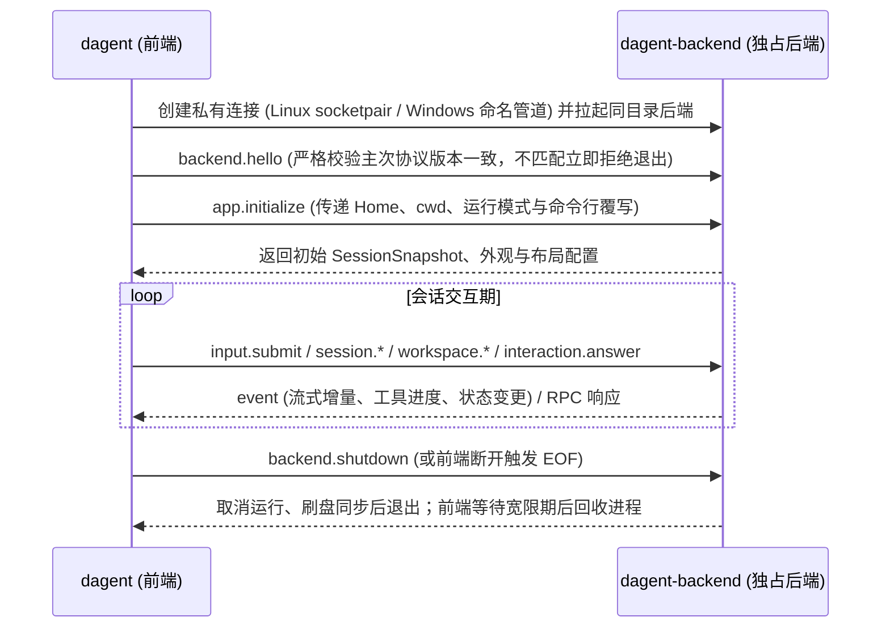

# protocol：前后端进程隔离与私有协议

DAgent 采用**一前端对应一私有后端**的双进程架构：前端进程（`dagent`）仅负责命令行解析、TUI 交互渲染与输出格式化；后端进程（`dagent-backend`）负责配置与密钥读取、模型请求、沙箱工具执行与 SQLite 会话持久化。两者通过操作系统私有匿名通道上的 JSON-RPC 2.0（UTF-8 JSON Lines）通信。

## 1. 进程与传输

### 进程隔离与安全边界
1. **无公共监听端口**：每个前端启动并独占自己的 `dagent-backend`（无后台共享 daemon、无监听 socket、无断线重连）。通道句柄仅由后端主进程接管，并立即设置禁止子进程继承（`CLOEXEC`），工具与 MCP 子进程无法访问该 IPC 通道。
2. **凭据与重依赖隔离**：前端不链接 SQLite、libcurl、MCP 或进程沙箱库，也不读取 `models.json`、登录凭据或提示词文件；所有敏感数据均留在后端进程内。
3. **独立进程组与信号收敛**：后端在独立进程组（Windows 为绑定 `KILL_ON_JOB_CLOSE` 的生命周期 Job 对象）中运行。终端 `Ctrl+C` / `SIGINT` 仅由前端捕获并转化为显式的 `run.cancel` 或退出流程，不会直接误杀后端导致数据库未同步。
4. **生命周期共命运**：当 IPC 通道出现 EOF（如前端崩溃退出），后端自动触发与 `backend.shutdown` 相同的清理流程（清空队列、取消执行、刷盘退出）。

## 2. 并发路由与多通道处理

后端收到前端 RPC 请求后，按操作性质分发到三个独立执行通道，保证界面操作永不被慢查询或模型推理阻塞：

| 执行通道 | 负责的 RPC 方法类别 | 设计目的 |
| --- | --- | --- |
| **读线程（即时通道）** | `backend.hello/shutdown`、`input.submit/recall_last`、`run.cancel`、`interaction.answer`、`session.snapshot/grants/cycle_permission/set_permission/toggle_planning/revoke_grant`、`model.list`、`provider.status/login.cancel` | 只做轻量校验与内存状态投递，微秒级返回，确保忙碌时仍可随时排队、取消、审批与撤权 |
| **命令线程（串行状态变更）** | `app.initialize`、`session.new/resume/select_model/compact`、`model.add`、`provider.model.add`、`ui.appearance.save` | 串行处理会话替换、配置文件原子写入与手动压缩启动 |
| **查询线程（只读与外部认证）** | `session.list/children/history/history_close`、`workspace.info/complete/git_status`、`agents.list`、`skills.list`、`memory.*`、`provider.login.start/wait/logout/models.list` | 隔离磁盘历史扫描、Git 状态采集与 OAuth 轮询，查询失败不影响正在执行的对话回合 |

**会话代次防重入（`session_generation`）**：每次新建、恢复会话或切换模型成功后，后端递增 `session_generation`。所有修改会话状态的请求必须携带当前 `{session_id, session_generation}`，过期请求直接返回 `stale_session`。

## 3. 事件流、快照水位与发送背压

### 3.1 事件信封与状态水位对齐
后端通过单向 `event` 通知向前端推送实时变化：
- **核心与控制事件**：包含流式文本/思考（`text` / `reasoning`）、工具生命周期（`tool_pending` / `tool_started` / `tool_output` / `tool_finished`）、上下文与轮次状态（`context` / `compacted` / `turn_ended`）、工作区变更通知（`workspace.changed`）以及交互请求（`interaction.requested` / `interaction.closed`）。对于流式 `tool_output`，后端按调用维护跨块 UTF-8 字节残片缓冲（`pending_chunks_`），仅推送完整的 UTF-8 字符前缀并在 `tool_finished` 时冲刷，防止多字节字符在管道分块边界被截断为乱码。
- **子 Agent 事件展平**：子会话产生的事件在后端自动展平，在信封顶层附带 `parent_session_id`、`model_call_id` 与 `agent` 名称，前端据此路由到对应子面板与父任务卡片。
- **水位防倒退（`seq` vs `state_seq`）**：每个发布的事件携带严格递增的 `seq`，每次获取的 `SessionSnapshot` 携带当时的 `state_seq`（若捕获快照期间有新事件发布，后端自动重读以确保 `state_seq` 不落后于已入队事件）。前端拒绝低于已处理水位的陈旧快照，避免异步快照覆盖更新的实时状态。

### 3.2 单一有序发送队列与背压控制
后端所有输出（RPC 响应与事件通知）均进入单一发送队列，由独立写线程顺序写出：
- 队列设置 `8 MiB` 软上限：当大量工具输出造成积压时，事件生产者在锁外阻塞等待容量（施加反向背压）。
- **控制响应免排队阻塞**：RPC 响应与错误直接入队、不等待容量上限，确保取消、回答和关闭指令在输出洪峰下依然即时响应。
