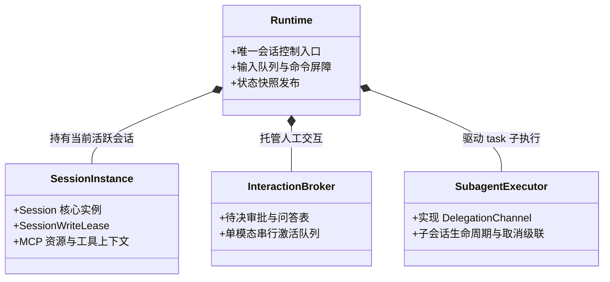
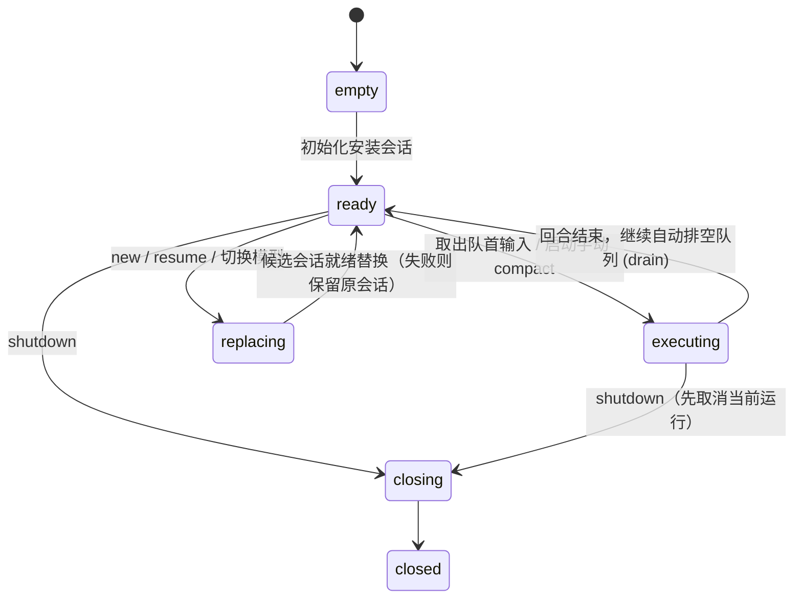

# runtime：会话控制、交互代理与子执行调度

`runtime` 模块（`dagent_runtime`）位于后端进程内、核心 `agent` 层之上，负责管理**会话生命周期状态机、用户输入排队、权限/问答交互等待队列、以及并发子 Agent 的创建与回收**。

## 1. 核心架构与职责边界

- **单一串行执行线程**：每个后端实例只有一个主会话执行线程负责出队输入、运行 `TurnRunner` 循环或执行手动压缩（`/compact`）。
- **即时控制通道**：输入入队（`submit`）、取回排队输入（`recall_last`）、取消当前运行（`cancel`）、回答审批/提问（`answer`）、切换权限模式（`cycle_permission`）与撤销授权（`revoke_grant`）均在调用线程通过短锁即时完成，不被正在运行的模型或工具阻塞。

## 2. 会话控制状态机与输入队列

### 关键调度规则
1. **输入排队与取回（FIFO）**：用户在模型忙碌时提交的普通消息直接进入内存队列并立即返回 `input_id`；当前回合或手动压缩结束后，执行线程自动按序取出下一条输入开启新回合（`drain`）。在某条排队输入尚未被执行线程取走前，用户可在空输入框按 `↑` 原子取回最后一条排队输入进行编辑。
2. **`unrestricted` 升权待确认门禁（`pending_permission_`）**：当用户请求切换到 `unrestricted` 且本会话尚未确认过风险警告时，系统进入待确认状态并弹窗提示；**在用户明确确认或取消前，执行线程暂停从输入队列取走任何排队消息**，防止排队任务在未经确认的高危权限下自动执行。
3. **接受屏障（Acceptance Barrier）**：输入提交、手动压缩与状态变更命令均设有接受屏障（`command_pending_`），确保 RPC 响应必然先于该操作触发的事件进入发送队列，且不会在命令切换瞬间被排队输入抢占。
4. **两阶段无损会话替换（`replacing`）**：执行 `/new`、`/resume` 或切换模型时，要求当前处于空闲状态。系统先在后台装配好新候选会话（若装配或恢复失败，原会话完好保留），成功后再于单次锁边界内原子替换当前会话、递增 `session_generation` 并通知前端。
   - **同会话切换模型**：复用当前会话的写租约（`SessionWriteLease`），严格继承当前会话的权限档（`mode`）、规划开关（`planning`）与启动只读限制（`read_only`），从持久记录重建内存上下文并写入新的 `system` 记录，同时清空临时文件追踪（`FileTracker`）、MCP 连接与临时会话授权。

## 3. 交互代理（`InteractionBroker`）

当主会话或并发子 Agent 需要人工审批（`Approver`）或向用户提问（`Asker`）时，统一交由 `InteractionBroker` 协调：

1. **多源并发请求、单模态串行展示**：多个并发工具或子 Agent 同时发起审批请求时，全部进入等待队列，但**同一时刻仅激活队首唯一一个请求**向前端发送 `interaction.requested`，避免前端弹出重叠模态框。
2. **一次性终结与取消联动**：用户提交回答后立即唤醒对应等待线程，并激活队列中的下一个请求。若当前回合或对应子任务被取消（`stop_token` 触发），等待中的交互立即以取消状态终结，并通知前端关闭弹窗。
3. **非交互模式降级**：在 `dagent run` 非交互模式下不装配人工代理；主会话遇到需人工审批的操作直接返回不可用错误，而符合条件的子 Agent 请求仍可路由给父模型自动审阅。

## 4. 子 Agent 委派执行（`SubagentExecutor`）

当主会话调用 `task` 控制动作时，`SubagentExecutor` 在并发任务线程上完成子会话的完整闭环：
1. **权限收窄与活上限绑定**：根据父会话当前实时权限与子 Agent 定义派生更严格的权限策略，并将父 `Policy` 绑定为子会话的动态上限（父会话运行中降权或撤销授权时，实时级联取消越权的子执行）。
2. **审批路由分发**：子会话需要审批时，若父会话处于无只读限制的 `workspace` / `unrestricted` 模式且开启了父审阅，优先投递至父 Dispatcher 邮箱由父模型审阅；否则（或父审阅失败/超时后）交由 `InteractionBroker` 转人工审批。
3. **事件透明转发与上下文隔离**：子会话运行期间产生的实时事件包装为 `SubEvent` 转发给前端展示，但**绝不写入父会话的消息历史**；子会话在函数返回前彻底销毁，仅向父模型回传最终结论文本与工具步骤摘要（`TaskView`）。
