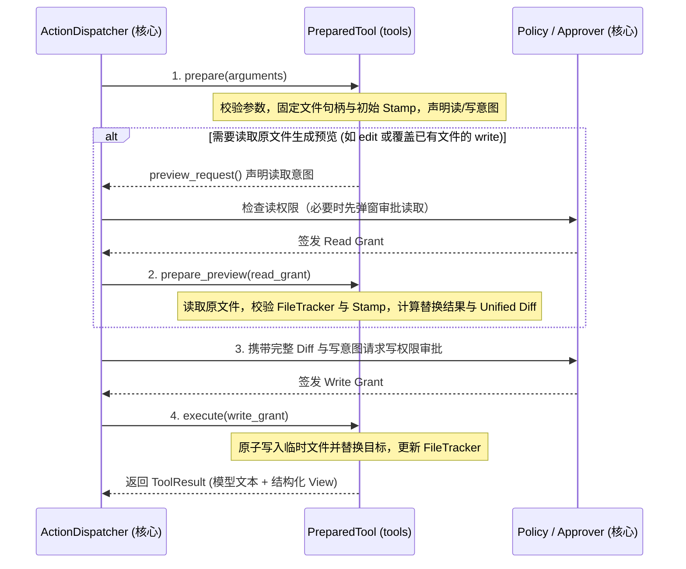

# tools：工具层与视图投影

`tools` 模块将底层能力（`workspace`、`exec`、`web`、`mcp`、`memory`）封装为面向大模型的标准工具：定义工具 Schema、校验参数、提取资源操作意图，并将执行结果拆分为**给模型的精简文本**与**给界面/历史记录的结构化视图（`View`）**。

**职责边界**：
- **只声明意图，不做权限决策**：工具在准备阶段生成 `PreparedIntent`（要读/写哪个路径、执行什么命令），允许、询问还是拒绝由核心 `Policy` 决定。
- **不负责并发调度与历史管理**：工具串并行分组、调用次数上限与消息回填由 `agent` 核心负责。
- **不抛异常出边界**：参数错误、文件变更冲突、命令超时或环境缺失均捕获并转化为带 `is_error = true` 的 `ToolResult` 文本，让模型自行感知并修正，不中断整轮对话。

## 1. 关键流程：两阶段准备与预览授权

为兼顾安全性（未获读授权前绝不读取敏感文件内容）与可审阅性（写审批弹窗需要展示准确的 Unified Diff），文件修改类工具采用**两阶段准备**流程：

### 防覆盖保护（`FileTracker`）
会话级 `Context` 维护模型在本会话内已读取或修改过的文件指纹表（`FileTracker`）：
- **先读后改与指纹自更新**：对已存在的文件调用 `edit` 或 `write` 前，若 `FileTracker` 中无该文件记录，直接报错要求模型先调用 `read`；写入成功后原子将新文件的 `Stamp` 写回 `FileTracker`，支持对同一文件连续 `edit` 而无需重复读取。
- **外部修改检测（Stale）**：若文件自上次读取/修改后被外部进程改动（`Stamp` 不一致），拒绝写入并提示模型重新读取。会话恢复后清空 `FileTracker`，强制模型重新确认文件当前状态。

## 2. 内置工具与 MCP 工具设计

| 工具 | 核心设计与安全机制 |
| --- | --- |
| `read` | 按行分页读取文本（自动剥离 CRLF/BOM，超长单行按 UTF-8 边界截断并预留底栏范围提示余量），目录路径直接列出子项；文件不存在时通过模糊匹配推荐最多 3 个相近路径 |
| `edit` | 要求 `old_string` 在文件内**精确且唯一匹配**（除非开启 `replace_all`）；失败时自动诊断「是否误带了行号前缀」或「缩进不一致」并给出行号提示 |
| `write` | 新建文件或覆盖已读文件；新建采用独占重命名防止覆盖并发创建的文件，覆盖已有文件时保留原换行符、BOM 与权限 |
| `bash` | 每次调用均为独立新进程（支持 `environment` 选择 `managed`、`project` 或 `skills/<name>` 环境）；准备阶段调用 `exec::analyze` 静态分析语法、只读性、危险命令与脚本目标（若目标脚本在本会话内修改过，自动提取最多 300 行相对 Git HEAD 的 Diff 证据 `script_evidence` 供 d3/人工复审）；受限模式下映射为 MXC 沙箱与回环网络代理；结果返回前清洗 ANSI 控制序列并预留状态行空间后按 UTF-8 边界居中截断（`BashView` 保留未居中截断输出） |
| `grep` / `glob` | 强制在只读 MXC 沙箱内调用托管 `rg`；采用双重过滤防线：先向沙箱传递 `read_exceptions`，再对 `rg` 产出的每条匹配结果逐一调用 `can_read` 剔除受保护/敏感路径；`glob` 按修改时间倒序排列 |
| `web_search` / `web_fetch` | 强制在只读 MXC 沙箱内经回环代理执行（见 [web](web.md)），支持会话内 LRU 页面缓存与 UTF-8 字节分页 |
| `memory` | 读写 `global` 或 `project` 作用域的 Markdown 记忆条目（见 [memory](memory.md)），所有模式下免审批串行执行 |
| `mcp__*` | 由 `McpHub` 将外部 MCP 工具包装为标准 `Tool`，持有 `mcp::Client` 共享引用；检测到连接断开时在结果中附带 `McpDisconnected` 信号交由核心在下一步边界自动重连 |

*(注：`todo`、`ask`、`exit_plan`、`task`、`skill` 在模型视角同样表现为工具，但由 `agent` 核心作为控制动作直接解析执行。)*

## 3. 界面数据：View

每个工具执行完成后，`ToolResult` 同时产出面向模型的精简文本（受 `max_result_bytes` 限制）和面向 UI 与持久化记录的强类型 `View`（序列化为带 `"kind"` 标签的 JSON）：

- **文件与搜索视图**：`ReadView`（读取行范围）、`FileChangeView`（Unified Diff 与增删行数）、`GrepView`（带匹配高亮区间的行列表）、`GlobView`（文件列表）。
- **执行与外部视图**：`BashView`（截断输出、退出码、实际沙箱后端/权限来源与获批网络目标）、`WebView`（URL/搜索词、状态码、分页偏移与正文）、`McpView`（原始内容块与结构化输出）。
- **控制与上下文视图**：`TodoView`（计划列表快照）、`AskView`（问题与用户回答）、`TaskView`（子 Agent 工具步骤摘要与最终结论）、`SkillView`（激活的技能路径）、`MemoryView`（记忆变更详情）。
