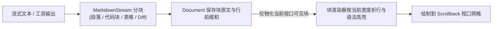

# 终端 UI 框架（`dagent_tui`）

`tui` 模块是 DAgent 自研的轻量级全屏终端 UI 框架，为上层交互界面（[ui](ui.md)）提供单元格双缓冲画布、弹性布局、流式文档虚拟滚动、输入解码与事件循环。

**两条核心设计承诺**：
1. **业务永不被渲染阻塞**：所有控件树、文档与事件处理器仅在单一渲染线程操作（无需加锁）；其他线程仅通过无锁/短锁队列 `post(fn)` 投递更新。
2. **静止零唤醒**：无输入、无业务更新、无活跃定时器时渲染线程完全休眠；变化密集时按最小帧间隔（16ms，约 60fps）自动合并重绘。

## 1. 七层架构设计

框架自底向上严格分层，下层不感知上层：

```text
L7 运行时   Runtime · Keymap · ScrollbackMouse        (事件循环、能力握手、定时器、命令与快捷键绑定)
L6 输入层   Decoder · EventRouter · InputBoxHandler   (VT/Kitty/控制台输入解码、模态栈与焦点路由)
L5 文档层   Document · Scrollback · MarkdownStream    (流式分块文档、按宽折行、虚拟视口滚动、源码选区复制)
L4 控件层   Text · Activity · Notice · InputBox       (基础无状态/编辑控件、ThemeTokens 语义令牌)
L3 布局层   Widget · Container · LayerStack           (行列弹性布局、基础层 + 多模态浮层叠放与鼠标命中)
L2 网格层   Surface · Cell · Style · 字素宽度         (双缓冲单元格画布、脏行差分出帧、UAX #29 字素切分)
L1 终端层   Terminal · EventWait                      (备用屏与 raw 模式守护、信号恢复、OSC 52 剪贴板)
```

## 2. 关键机制与渲染流水线

### 2.1 终端管理与能力握手（L1 & L7）
- **全路径状态还原**：`Terminal` 在构造时进入备用屏与 raw 模式，在正常析构、收到退出信号（SIGINT/SIGTERM/SIGHUP 或 Windows 控制台关闭事件）或进程异常终止（`atexit`）时均保证还原终端状态。
- **非阻塞能力握手**：启动首帧不等待终端应答；后台异步查询终端是否支持真彩色、同步输出（Synchronized Output）、字素宽度模式（mode 2027）、Kitty 键盘协议以及当前终端背景色（OSC 11），收到应答后通过 `on_caps` 回调动态切换明暗主题与渲染特性。

### 2.2 双缓冲差分出帧与样式系统（L2 & L4）
- **单元格双缓冲（`Surface`）**：所有控件先绘制在内存网格上（天然支持浮层遮挡与局部重绘）。出帧时逐行比对上一帧与当前帧，仅输出发生变化的单元格区间，配合终端同步输出消除闪烁。
- **Unicode 字素宽度**：按 Unicode UAX #29 将 UTF-8 切分为字素簇（Grapheme Cluster），准确计算中文宽字符、组合字符与多码点 Emoji 的终端列宽。
- **色彩回退与 OSC 8 超链接**：支持 24 位真彩色与携带显式 256 色回退索引的语义令牌（`ThemeTokens`）；单元格内置进程级去重的超链接 ID，出帧时自动闭合 `OSC 8` 超链接转义序列。

### 2.3 流式长文档与虚拟滚动（L5）
针对不断增长的长对话场景，`Document` 与 `Scrollback` 采用**原文存储与按需物化分离**的设计：



- **只物化可见区域**：无论历史对话有多长，每帧仅对视口可见范围内的块执行折行与高亮物化，滚动与追加开销恒定。
- **内容锚定与自适应缩放（Resize Reflow）**：终端窗口缩放触发 `check_size()` 重分配画布并广播 `resize` 事件；文档按新宽度重新折行时，滚动位置跟随内容字节锚点（`Anchor{block_id, byte_in_block}`）而非行号，阅读位置不会跳变；贴底时自动跟随新流式输出，上翻阅读时保持视口静止。
- **跨折行源码复制**：每个渲染片段保留指向原始文本的字节偏移（装饰符与边框标记为无源），鼠标拖选复制到剪贴板（OSC 52）时直接提取纯净的 Markdown/代码原文，不含因终端折行产生的硬换行。

### 2.4 模态栈、括号粘贴与事件路由（L6）
控件本身只负责布局与绘制，按键与鼠标交互由独立的 `EventHandler` 处理：
- **括号粘贴防打散（Bracketed Paste，Mode 2004）**：`Decoder` 拦截 `\x1b[200~` 至 `\x1b[201~` 序列，将粘贴的多行代码/文本打包为单一原子 `paste` 事件，防止粘贴内容中的换行符被终端拆成多次回车误触发提交。
- **键盘三级路由**：按键事件严格按「**模态浮层栈（栈顶优先） → 当前焦点处理器 → 全局快捷键（`Keymap`）**」顺序传递，首个消费事件的处理器终止传递。打开弹窗只需压栈，关闭只需出栈，无需编写复杂的状态判断。
- **鼠标命中与拖拽锁定**：由 `LayerStack` 自顶向下寻找命中的控件；有模态浮层时拦截浮层外点击防止穿透；鼠标按下后的拖拽事件始终锁定发送给按下时的控件。
