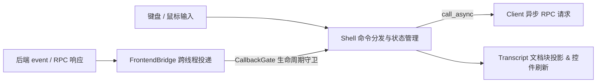

# ui：应用层终端交互界面

`ui` 模块（`dagent_ui`）基于 [TUI 框架](tui-framework.md) 构建 DAgent 的全屏终端交互界面。它运行在前端进程中，只持有协议客户端（`client::Client`）、DTO 与视图状态；所有业务真值（会话状态、队列、权限、模型）均由后端 `runtime` 维护，通过 [私有协议](protocol.md) 异步交互。

## 1. 界面布局与控件结构

```text
LayerStack (根图层栈)
├── 基础层：主工作区 (Vertical Container)
│   ├── HeaderBar              顶部栏：品牌、会话标题、权限模式 Chip、当前模型、Git 分支
│   ├── AgentTabs              标签栏：主会话 (main) 与各并发/历史子 Agent 视图切换（无子任务时隐藏）
│   ├── Workspace              三栏主区 (Horizontal：左右侧栏可互换或自动折叠)
│   │   ├── SidePanel (左)     导航栏 (Navigator)：SESSIONS / GIT / SKILLS / AGENTS
│   │   ├── 主对话区 (中)       自适应居中阅读宽度 (默认 88–120 列，双栏 Diff 可突破至 176 列)
│   │   │   ├── ScrollFrame    新会话显示居中 WelcomeView；对话期显示 Scrollback 与底部未读行数提示
│   │   │   ├── Activity       忙碌状态行：阶段、耗时、累计 Token 与生成速率 (空闲时高 0)
│   │   │   ├── QueueLabel     排队输入提示行：显示已入队的 FIFO 消息 Chip 与 ↑ 取回提示
│   │   │   └── PromptBox      圆角多行输入框：1–8 行自适应增高、权限/模型状态尾行与快捷键提示
│   │   └── SidePanel (右)     状态栏 (Status)：SESSION / CONTEXT / PLAN / CHANGED / RUNNING AGENTS / MCP
│   └── HintBar                底部栏：当前工作目录路径与随上下文动态变化的键位提示
└── 浮层栈 (Overlays)
    └── Completion (补全) · Panel (列表/命令/记忆/会话) · ModelPicker (模型与登录) · SettingsDialog · ApprovalDialog · ToastStack
```

### 响应式双侧栏设计
- **导航栏（`Ctrl+B`）与状态栏（`Ctrl+T`）**：支持自动随终端宽度折叠（终端 ≥170 列时自动展开双栏，缩小时优先收起导航栏，`< 80` 列时收起状态栏并在顶栏显示上下文百分比）。
- **分节自由编排**：十个信息分节（`sessions`、`git`、`skills`、`agents`、`session`、`context`、`plan`、`changed`、`running_agents`、`mcp`）可通过 `/settings` 的 Layout 页面在左右两栏或隐藏列之间自由移动与排序。
- **按需防抖刷新**：Git 状态在轮次结束、工具完成、终端重获焦点或收到后端 `workspace.changed`（inotify 监听）通知时，经前端 120ms 防抖异步查询更新，空闲时零轮询。

## 2. 外观与设置

外观系统由 `ui.appearance` 与 `ui.layout` 驱动（配色令牌详见 [主题设计](opencode-theme.md)）：
- **实时预览与原子保存**：打开 `/settings`（或 `/theme`）浮层修改明暗模式（`auto`/`dark`/`light`）、背景（`solid`/`transparent`/自定义色）、强调色、面板风格（`filled`/`outline`）、密度（`comfortable`/`compact`）、图标集（`unicode`/`nerd`/`ascii`）、Diff 视图（`auto`/`unified`）及布局宽度时，**全界面即时生效预览**；按 `Enter` 经后端 RPC 原子写入配置文件，按 `Esc` 立即还原打开前的状态。
- **模态背景变暗**：当居中模态浮层（命令面板、设置、模型选择、审批弹窗）打开时，应用层在重绘基础层后将背景单元格前景色向底色混合 60%，突出当前焦点浮层。

## 3. 事件驱动与单线程生命周期

前端不设业务工作线程，所有 UI 状态更新严格收敛在渲染线程：



- **代次隔离（Generation）**：`Shell` 跟踪当前会话的 `session_id` 与 `session_generation`，自动丢弃迟到的旧会话事件或过期补全结果；通过 `CallbackGate` 确保界面销毁后在途异步回调安全失效。
- **按需分页回放**：恢复主会话或用户切换到某个历史子 Agent 标签页时，通过 `HistoryPager` 调用 `session.history` 分页拉取记录并流式追加到对应 `Transcript`，不阻塞界面响应。

## 4. 输入、排队与三种内联补全

1. **无阻塞发送、排队取回与全局快捷键**：无论后端是否忙碌，输入框按 `Enter` 均立即通过 `input.submit` 提交（忙碌时进入后端 FIFO 队列并在输入框上方显示 `QUEUED` 标签）；输入框为空时按 `↑` 调用 `input.recall_last` 取回最后一条尚未执行的排队消息。支持 `Shift+Tab` 单键循环切换权限模式（`ask` / `workspace` / `unrestricted`）以及 `Ctrl+M` 打开模型与登录面板。
2. **三种内联补全（`CompletionController`）**：
   - `/command`：匹配已注册的斜杠命令（与 `Ctrl+P` 命令面板共用同一数据源），`Enter` 直接执行。
   - `@file`：经 80ms 防抖请求后端 `workspace.complete`（`ripgrep` + `fzy` 模糊排序），插入工作区相对路径。
   - `$skill`：匹配已发现的全局技能，插入 `$name ` 引用。

## 5. 对话投影与卡片交互

`Transcript` 将实时协议事件或历史条目投影为 `Document` 中的结构化块：

- **流式思考与正文**：思考内容默认折叠为 `✻ Thought for N.Ns`（可按 `Ctrl+R` 全局展开/收起）；正文通过 `MarkdownStream` 实时渲染标题、列表、代码块与表格，并自动将 URL 与项目内真实存在的相对文件路径转换为可点击的 `OSC 8` 超链接。
- **工具调用卡片与折叠**：每个工具展示「状态图标 + 名称 + 参数摘要 + 右对齐统计」，输出内容以 `⎿` 挂钩缩进挂载在下方。超出默认行数阈值的工具输出自动折叠，支持按 `Ctrl+O` 展开/收起。
- **自适应双栏 / 统一 Diff**：文件修改卡片（`FileChangeView`）在 `diff: auto` 且主区宽度充足（两侧各至少 60 列代码区）时自动采用左右并排双栏 Diff，窄屏自动回退为统一 Diff，并支持按 `Ctrl+D` 随时切换。
- **子 Agent 嵌套进度与多 Pane 切换**：主会话中的 `Task` 卡片实时原位刷新子 Agent 的工具调用列表与耗时；同时顶部 `AgentTabs`（或 `Ctrl+A` / `/agents`）支持随时切换到任意子 Agent 的独立全屏对话流查看完整上下文。
- **权限审批、风险确认与问答弹窗（`ApprovalDialog`）**：高风险操作（宿主执行、受保护写入、敏感读取及 `unrestricted` 升权确认）使用 `error` 边框警示，常规请求使用 `warning` 边框；权限审批内置语法高亮命令/Diff 预览，支持一键单次允许（`y`）、本会话允许（`a`）、拒绝（`n`）或附带说明拒绝（`e`）；承载 `ask` 提问时支持数字键 `1–9` 单选、`Space` 多选、`Enter` 提交及 `Other...` 自由文本输入。
